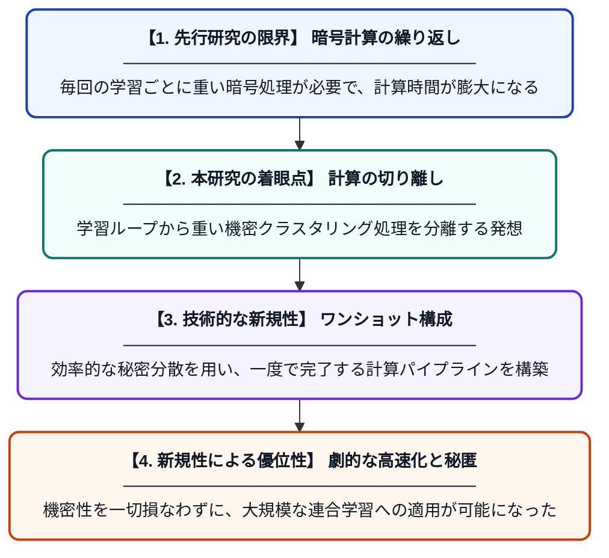

# 効率的な秘密分散を用いた連合学習向けの実用的機密クラスタリング

**Original Title**: *Practical Confidential Clustering for Federated Learning using Efficient Secret-Sharing*

> **💡 一言要約**: 計算負荷を抑え機密を守る、実用的な連合学習の新手法

| 項目 | 内容 |
|---|---|
| **著者** | C Prigent, SB Mokhtar |
| **掲載誌** | Cryptology ePrint Archive 2026 |
| **アラートキーワード** | one shot |
| **PDF** | [https://eprint.iacr.org/2026/2839.pdf](https://eprint.iacr.org/2026/2839.pdf) |
| **原文リンク** | [https://eprint.iacr.org/2026/2839.pdf](https://eprint.iacr.org/2026/2839.pdf) |
| **PDF版要約** | [README.pdf](./README.pdf) |

---

## 📊 新規性の図解（先行研究との違いと本研究のブレークスルー）

## 📝 要約

連合学習において、プライバシーを保護しつつ参加者をグループ化（クラスタリング）する効率的な手法を提案しています。重い暗号計算を各学習ラウンドから切り離し、一度の処理で完結させる「ワンショット・アーキテクチャ」により、高い機密性と実用的な計算速度を両立させました。

## ❓ どんな問題に取り組んだか

連合学習で参加者のデータ特性が異なる場合、精度の向上のためにクラスタリングが有効ですが、その際のプライバシー保護計算は極めて高負荷でした。既存手法では毎回の学習ループで複雑な暗号処理を行う必要があり、大規模なシステムでの実行が困難という課題がありました。

## ✨ 何が新しい？何がすごい？（新規性）

本研究は、重い暗号計算を毎ラウンドの学習ループから分離し、1回の手順で完結させる「デカップリング・ワンショット・アーキテクチャ」を導入しました。効率的な秘密分散（Secret-Sharing）技術をパイプラインに組み込むことで、情報の機密性を維持したまま計算・通信コストを劇的に削減することに成功しています。これにより、先行研究では難しかった「高い機密性」と「実用的なスケーラビリティ」の両立を初めて実現しました。

## 🎓 大学1年生向けの解説

「連合学習」はみんなのデータを1箇所に集めずにAIを育てる技術ですが、ユーザーの好みがバラバラだと学習がうまく進みません。そこで、似た者同士を秘密でグループ分けする必要がありますが、これには膨大な計算時間が必要でした。この研究では、その難しい計算を「学習のついでに何度もやる」のではなく、「最初に効率よく1回で終わらせる」仕組みを作りました。その結果、個人の秘密をしっかり守りながら、サクサクとAIを賢くできるようになりました。
