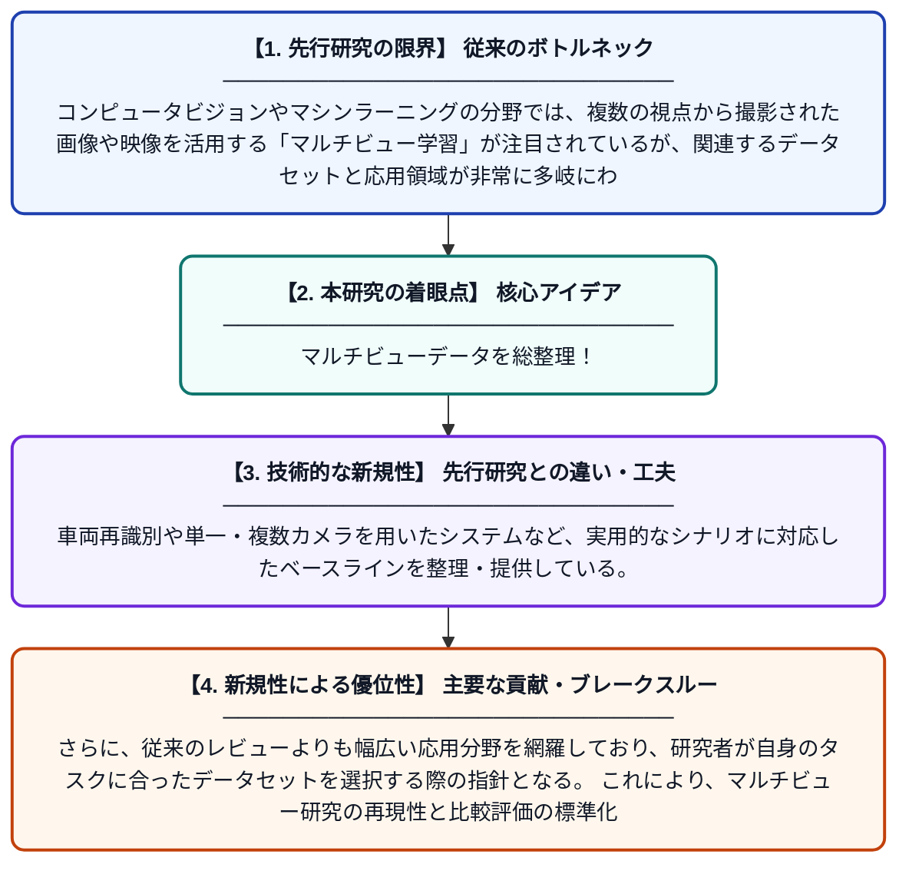

# マルチビューデータセットとその応用に関する包括的レビュー

**Original Title**: *A comprehensive review of multi-view datasets and applications*

> **💡 一言要約**: マルチビューデータを総整理！

| 項目 | 内容 |
|---|---|
| **著者** | F Hajri, H Fradi, MA Mahjoub |
| **掲載誌** | The Visual Computer 2026 |
| **アラートキーワード** | Multi Camera Tracking |
| **原文リンク** | [https://link.springer.com/article/10.1007/s00371-026-04565-0](https://link.springer.com/article/10.1007/s00371-026-04565-0) |
| **PDF版要約** | [README.pdf](./README.pdf) |

---

## 📊 新規性の図解（先行研究との違いと本研究のブレークスルー）

## 📝 要約

本論文は、複数の視点から撮影されたデータ（マルチビューデータ）を対象としたデータセットと応用事例を網羅的にレビューした研究である。車両の再識別や単一・複数カメラを用いたシステムなど、多様なタスクに対するベースラインを提供している。マルチビュー学習の分野における研究者が参照すべき体系的な知識基盤の構築を目指している。

## ❓ どんな問題に取り組んだか

コンピュータビジョンやマシンラーニングの分野では、複数の視点から撮影された画像や映像を活用する「マルチビュー学習」が注目されているが、関連するデータセットと応用領域が非常に多岐にわたり、研究者が全体像を把握しにくい状況にあった。特に、どのデータセットがどのタスクに適しているかを体系的にまとめた資料が不足していた。

## ✨ 何が新しい？何がすごい？（新規性）

既存のサーベイ論文がマルチビュー学習の手法論に偏りがちであったのに対し、本論文はデータセットと応用事例そのものに焦点を絞った点が新しい。車両再識別や単一・複数カメラを用いたシステムなど、実用的なシナリオに対応したベースラインを整理・提供している。さらに、従来のレビューよりも幅広い応用分野を網羅しており、研究者が自身のタスクに合ったデータセットを選択する際の指針となる。これにより、マルチビュー研究の再現性と比較評価の標準化に貢献している。

## 🎓 大学1年生向けの解説

スマートフォンや防犯カメラなど、複数のカメラで同じ対象を異なる角度から撮影したデータを「マルチビューデータ」と呼びます。このような複数視点のデータを使うと、物体の形や位置をより正確に把握できるようになります。でも、研究で使えるデータセット（練習用のデータの集まり）がたくさんありすぎて、どれを使えばいいかわからないという問題がありました。この論文は、そういったデータセットを一つ一つ丁寧に整理して、「こんな研究にはこのデータが使えますよ」という便利なガイドブックを作ったものです。
