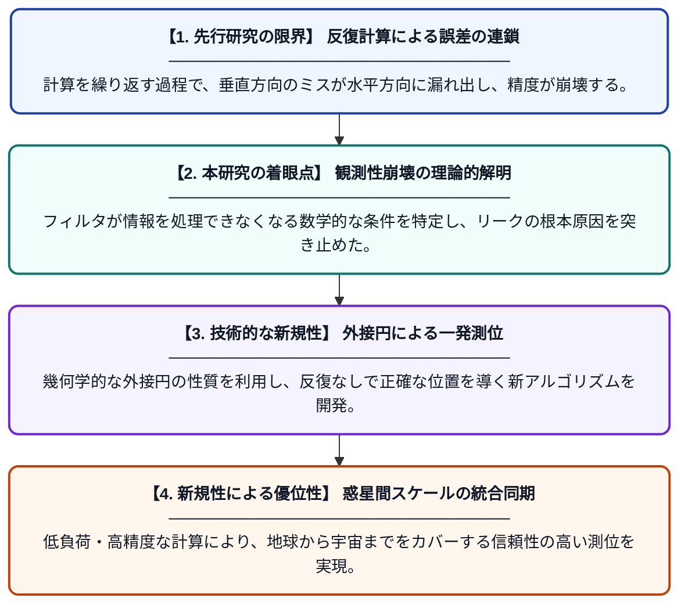

# K-PROTOCOLにおけるカルマンフィルタの観測性崩壊、シングルパス外接円三辺測量、および惑星間同期：地上と宇宙の統合

**Original Title**: *Kalman Filter Observability Collapse, Single-Pass Bounding-Circle Trilateration, and Interplanetary Synchronization in the K-PROTOCOL: Unifying Terrestrial …*

> **💡 一言要約**: 宇宙規模の測位ミスを防ぐ次世代同期プロトコル

| 項目 | 内容 |
|---|---|
| **著者** | YK Moon |
| **掲載誌** | Zenodo Preprints 2026 |
| **アラートキーワード** | kalman filter |
| **PDF** | [https://www.researchgate.net/profile/Yk-Moon/publication/417822001_Covariant_Reconstruction_SI_Metrology_and_K_Protocol_Core_II_Moon_2026pdf/data/6af6674f4f874d57084b6047/Covariant-Reconstruction-SI-Metrology-and-K-Protocol-Core-II-Moon-2026.pdf](https://www.researchgate.net/profile/Yk-Moon/publication/417822001_Covariant_Reconstruction_SI_Metrology_and_K_Protocol_Core_II_Moon_2026pdf/data/6af6674f4f874d57084b6047/Covariant-Reconstruction-SI-Metrology-and-K-Protocol-Core-II-Moon-2026.pdf) |
| **原文リンク** | [https://www.researchgate.net/profile/Yk-Moon/publication/417822001_Covariant_Reconstruction_SI_Metrology_and_K_Protocol_Core_II_Moon_2026pdf/data/6af6674f4f874d57084b6047/Covariant-Reconstruction-SI-Metrology-and-K-Protocol-Core-II-Moon-2026.pdf](https://www.researchgate.net/profile/Yk-Moon/publication/417822001_Covariant_Reconstruction_SI_Metrology_and_K_Protocol_Core_II_Moon_2026pdf/data/6af6674f4f874d57084b6047/Covariant-Reconstruction-SI-Metrology-and-K-Protocol-Core-II-Moon-2026.pdf) |
| **PDF版要約** | [README.pdf](./README.pdf) |

---

## 📊 新規性の図解（先行研究との違いと本研究のブレークスルー）

## 📝 要約

従来のカルマンフィルタや重み付き最小二乗法において、垂直方向の誤差が水平状態に混入する「観測性の崩壊」という現象を理論的に証明しました。この問題を解決するため、反復計算を必要としない「シングルパス外接円三辺測量」を用いた新しい通信・測位プロトコルを提案し、地上から惑星間に至る高精度な同期を可能にしました。

## ❓ どんな問題に取り組んだか

拡張カルマンフィルタ（EKF）などの従来手法では、特定の条件下で「垂直状態リーク」が発生し、垂直方向の不確かさが水平方向の推定精度を破壊する課題がありました。特に高速移動体や長距離の惑星間通信において、この数学的な観測性の欠如が測位の信頼性を大きく損なう要因となっていました。

## ✨ 何が新しい？何がすごい？（新規性）

本研究の最大の特徴は、カルマンフィルタが特定の幾何学的配置で「観測性崩壊」を起こすことを数学的に厳密に証明し、その回避策を示した点にあります。従来の反復的な最適化手法に頼らず、外接円を用いた幾何学的な「シングルパス（1回の計算）」で解を導く手法を導入したことで、計算負荷を劇的に削減しました。これにより、地上と惑星間という異なるスケールの測位システムを単一の「K-PROTOCOL」で統合的に運用できる道を開きました。

## 🎓 大学1年生向けの解説

GPSのような仕組みで自分の位置を知る際、これまでは「何度も計算し直して正解に近づける」という方法が主流でしたが、これには計算の途中でズレが積み重なる弱点がありました。この研究は、そのズレがなぜ起きるのかを数学で解明し、たった1回の計算で正確な位置を出す新しい方法を発明しました。これにより、地球上だけでなく火星のような遠い惑星との間でも、正確な時間の同期やナビゲーションができるようになります。宇宙時代の新しい「定規」を作ったような研究です。
