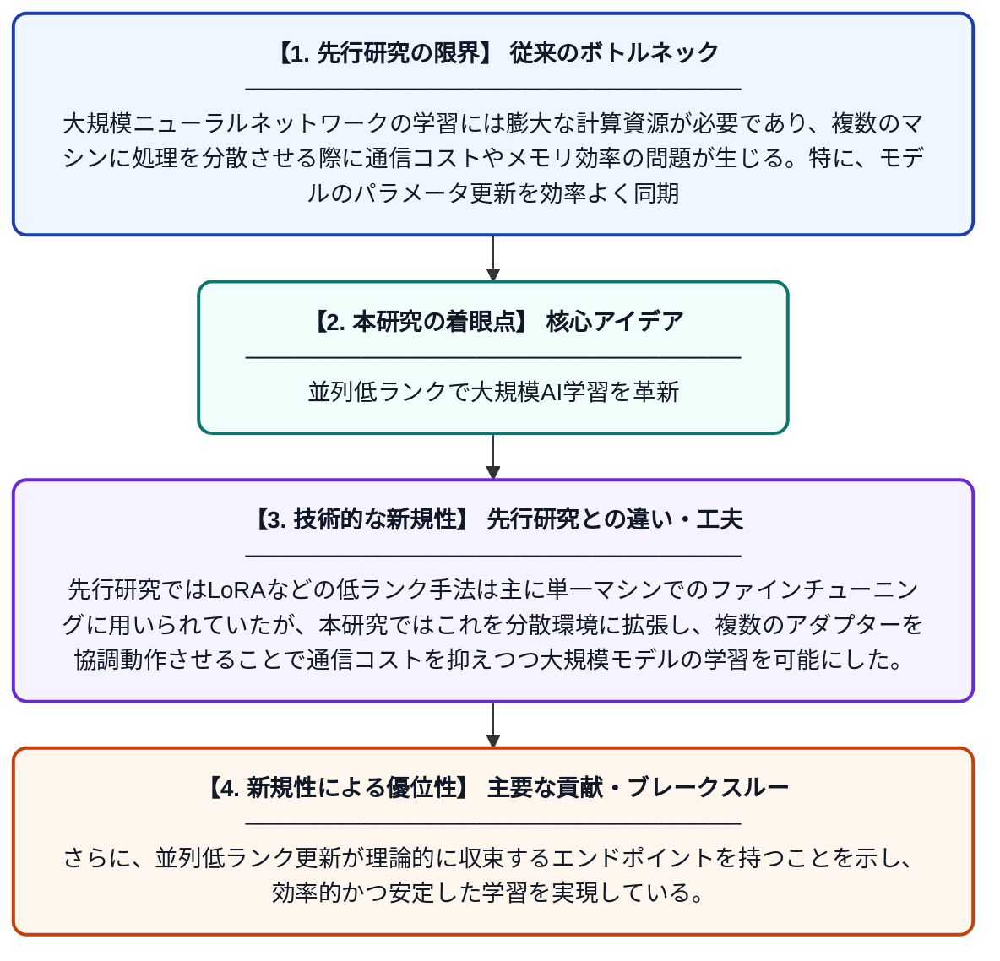

# 並列低ランク更新を用いた大規模ニューラルネットワークの分散学習

**Original Title**: *DOCTOR OF PHILOSOPHY at the MASSACHUSETTS INSTITUTE OF TECHNOLOGY September 2024© 2024 Minyoung Huh. This work is licensed under a CC BY-NC-ND 4.0 license.*

> **💡 一言要約**: 並列低ランクで大規模AI学習を革新

| 項目 | 内容 |
|---|---|
| **著者** | M Huh |
| **掲載誌** | MIT PhD Thesis 2024 |
| **アラートキーワード** | distributed deep learning ... |
| **PDF** | [https://dspace.mit.edu/server/api/core/bitstreams/23122df6-87bd-418f-b5b5-55dcfdb94c8e/content](https://dspace.mit.edu/server/api/core/bitstreams/23122df6-87bd-418f-b5b5-55dcfdb94c8e/content) |
| **原文リンク** | [https://dspace.mit.edu/server/api/core/bitstreams/23122df6-87bd-418f-b5b5-55dcfdb94c8e/content](https://dspace.mit.edu/server/api/core/bitstreams/23122df6-87bd-418f-b5b5-55dcfdb94c8e/content) |
| **PDF版要約** | [README.pdf](./README.pdf) |

---

## 📊 新規性の図解（先行研究との違いと本研究のブレークスルー）

## 📝 要約

本論文は、大規模なニューラルネットワークを効率的に学習するために、並列低ランクアダプターを活用した分散フレームワークを提案している。複数の低ランク更新を並列に適用することで、モデルの収束を効果的に達成する手法を開発した。これにより、大規模モデルの分散学習における計算効率と通信コストの課題に対処している。

## ❓ どんな問題に取り組んだか

大規模ニューラルネットワークの学習には膨大な計算資源が必要であり、複数のマシンに処理を分散させる際に通信コストやメモリ効率の問題が生じる。特に、モデルのパラメータ更新を効率よく同期させながら高品質な収束を達成することは困難な課題であった。

## ✨ 何が新しい？何がすごい？（新規性）

本研究の主要な新規性は、低ランク行列分解の概念をアダプターとして並列に適用する分散学習フレームワークの提案にある。先行研究ではLoRAなどの低ランク手法は主に単一マシンでのファインチューニングに用いられていたが、本研究ではこれを分散環境に拡張し、複数のアダプターを協調動作させることで通信コストを抑えつつ大規模モデルの学習を可能にした。さらに、並列低ランク更新が理論的に収束するエンドポイントを持つことを示し、効率的かつ安定した学習を実現している。

## 🎓 大学1年生向けの解説

AIのモデルは非常に大きくなっており、一台のコンピュータだけでは学習させることが難しくなっています。この研究では、多くのコンピュータが協力してAIを学習させる際に、情報のやり取りを少なくしながらも効率よく学習できる新しい方法を開発しました。具体的には「低ランクアダプター」という数学的なテクニックを使って、それぞれのコンピュータが担当する小さな更新を並列に行い、最終的に一つの賢いモデルに仕上げるという仕組みです。これにより、巨大なAIモデルをより速く・安く・賢く学習させることが可能になります。
