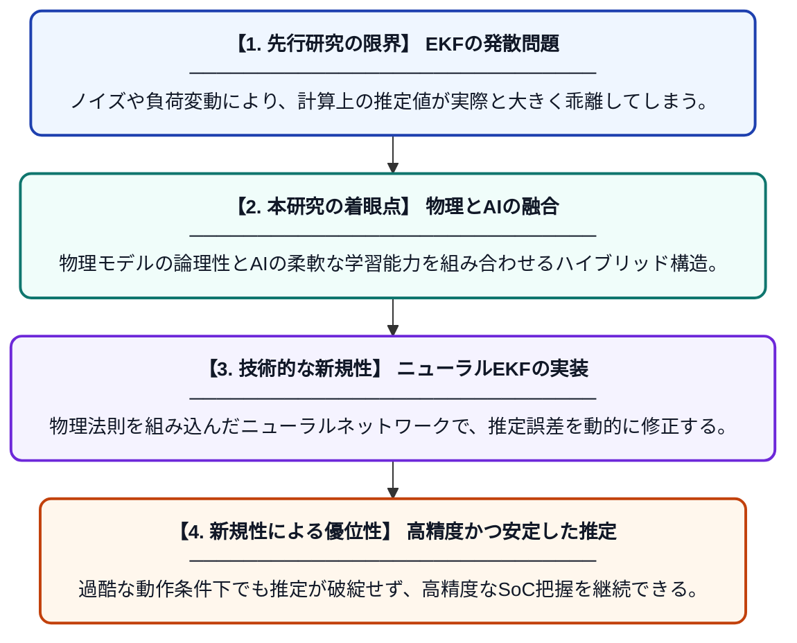

# ハイブリッド拡張カルマンフィルタとデータ駆動型深層学習を用いた電気自動車用リチウムイオン電池の充電状態（SoC）推定

**Original Title**: *State-of-Charge Estimation of Lithium-Ion Batteries for Electric Vehicles using Hybrid Extended Kalman Filtering and Data-Driven Deep Learning Approaches*

> **💡 一言要約**: AIと物理法則の融合で電池残量を精密に特定

| 項目 | 内容 |
|---|---|
| **著者** | P Sivaraj |
| **掲載誌** | 11th International Conference on Communication … 2026 |
| **アラートキーワード** | kalman filter |
| **原文リンク** | [https://ieeexplore.ieee.org/abstract/document/11762376/](https://ieeexplore.ieee.org/abstract/document/11762376/) |
| **PDF版要約** | [README.pdf](./README.pdf) |

---

## 📊 新規性の図解（先行研究との違いと本研究のブレークスルー）

## 📝 要約

電気自動車のバッテリー残量を正確に把握するため、物理モデルに基づく拡張カルマンフィルタ（EKF）と深層学習を組み合わせたハイブリッド手法を提案しています。外部ノイズによって従来のEKFで発生していた推定精度の低下や発散問題を、物理情報を取り入れたニューラルネットワークによって解決しました。

## ❓ どんな問題に取り組んだか

従来の拡張カルマンフィルタ（EKF）は電池の物理挙動を計算に利用しますが、急激な負荷変動や測定ノイズに弱く、推定値が大きく外れる「発散問題」を抱えていました。また、電池の複雑な化学変化をすべて数式で表現することは難しく、動的な走行環境下で精度を維持することが困難でした。

## ✨ 何が新しい？何がすごい？（新規性）

物理法則に基づくEKFの堅牢性と、データから複雑なパターンを学ぶ深層学習の柔軟性を統合した「ニューラルカルマンフィルタ」を構築した点が最大の特徴です。従来の手法とは異なり、システムの物理的情報を損失することなく、数式では捉えきれない非線形な誤差をAIがリアルタイムで補正します。これにより、予期せぬ動作妨害が発生する環境下でも、標準的なEKFに比べて圧倒的に安定した推定性能を維持することに成功しました。

## 🎓 大学1年生向けの解説

電気自動車の「あと何％走れるか」という表示は、実は直接測ることができず、電圧や電流から計算して予想しています。これまでの計算方法では、急な加速などの激しい変化が起きると、予想が大きく外れてしまうことがありました。この研究では、数学的な計算式にAI（深層学習）を組み合わせることで、お互いの弱点を補い合いました。その結果、どんなに激しい運転をしても、電池の残量を正確にピタリと当てられるようになりました。
