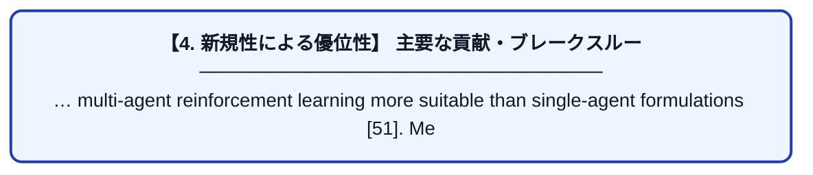

# Sustainable Multi-Zone Greenhouse Fertigation Through Reliability-Aware Sensing, Spatiotemporal Graph Learning, and Multi-Agent Reinforcement Learning

| 項目 | 内容 |
|---|---|
| **著者** | X Zhang, M Lin, Y Bai, H Yang, J Liu, J Pu, Y Song |
| **掲載誌** | Sustainability 2026 |
| **アラートキーワード** | multi agent |
| **PDF** | [https://www.mdpi.com/2071-1050/18/21/11090/pdf](https://www.mdpi.com/2071-1050/18/21/11090/pdf) |
| **原文リンク** | [https://www.mdpi.com/2071-1050/18/21/11090/pdf](https://www.mdpi.com/2071-1050/18/21/11090/pdf) |
| **PDF版要約** | [README.pdf](./README.pdf) |

---

## 📊 新規性の図解（先行研究との違いと本研究のブレークスルー）

## 📝 要約

… multi-agent reinforcement learning more suitable than single-agent formulations [51]. Methods such as multi-agent deep deterministic policy gradient (MADDPG) and multi-agent … Therefore, graph-based multi-agent reinforcement learning is integrated with …
