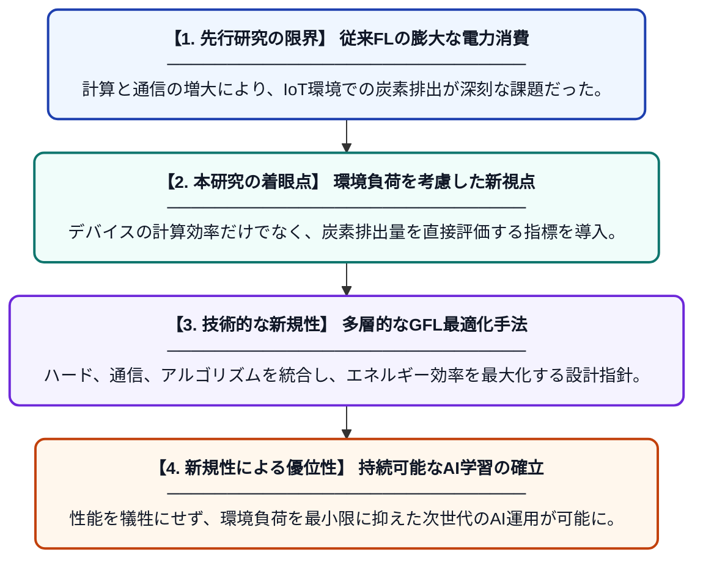

# 持続可能なIoTのためのグリーン連合学習：省エネアーキテクチャ、炭素意識型の最適化、およびエッジ主導の持続可能性に関する系統的レビュー

**Original Title**: *Green Federated Learning for sustainable IoT: a systematic review of energy-efficient architectures, carbon-aware optimization, and edge-driven sustainability*

> **💡 一言要約**: 環境に優しいAI学習の未来図

| 項目 | 内容 |
|---|---|
| **著者** | M Mollasafarikavari, R Khorsand, M Ramezanpour |
| **掲載誌** | The Journal of Supercomputing 2026 |
| **アラートキーワード** | Federated Learning |
| **原文リンク** | [https://link.springer.com/article/10.1007/s11227-026-09030-2](https://link.springer.com/article/10.1007/s11227-026-09030-2) |
| **PDF版要約** | [README.pdf](./README.pdf) |

---

## 📊 新規性の図解（先行研究との違いと本研究のブレークスルー）

## 📝 要約

IoT環境における連合学習のエネルギー消費と炭素排出を削減するための「グリーン連合学習（GFL）」について網羅的に調査した論文です。省エネ型アーキテクチャや炭素排出を考慮した最適化、エッジコンピューティングによる持続可能なシステム構築の最新動向をまとめています。

## ❓ どんな問題に取り組んだか

連合学習はプライバシーを守りつつ学習が可能ですが、多数のIoTデバイスを稼働させるため、膨大なエネルギー消費と炭素排出が課題となっています。特にリソースの限られたデバイス群において、環境負荷を抑えながら学習効率を維持する手法が不足していました。

## ✨ 何が新しい？何がすごい？（新規性）

本論文は、連合学習の「グリーン化」という視点から、ハードウェア、通信、アルゴリズムの各レイヤーを横断的に調査した初の包括的なレビューです。単なる高速化ではなく、炭素排出量を直接的な指標として組み込んだ最適化手法や、エッジ主導の持続可能な構造を体系化しています。これにより、環境保護と技術発展を両立させる具体的な設計指針を提示した点が非常に重要です。

## 🎓 大学1年生向けの解説

AIを賢くするためにはたくさんの計算が必要で、実は地球に多くの負担（電気の使いすぎ）をかけています。この論文では、スマートフォンなどの身近な機器を使いながら、電気をなるべく使わずにAIを育てる「グリーン連合学習」という技術を詳しく解説しています。例えば、無駄な通信を減らしたり、よりクリーンなエネルギーで動かしたりする工夫が紹介されています。これによって、プライバシーを守りながら、地球に優しい方法で最新のAIを作れるようになります。
