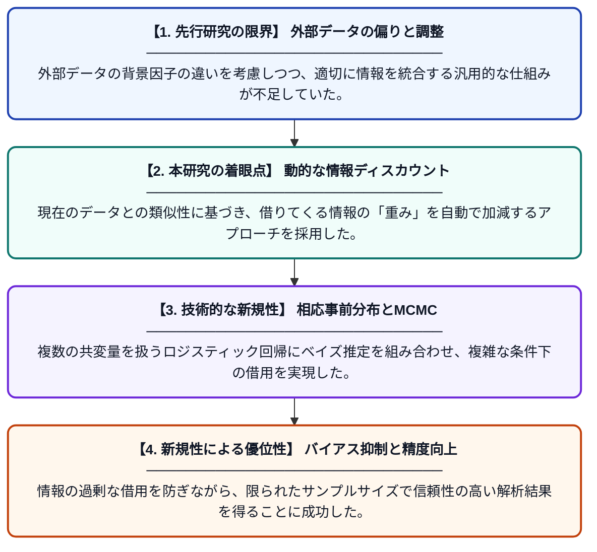

# Rパッケージ「psBayesborrow」：共変量を考慮したベイズ的外部データ借用の実装

**Original Title**: *Package {psBayesborrow}*

> **💡 一言要約**: 外部データを賢く借りるベイズ統計の新ツール

| 項目 | 内容 |
|---|---|
| **著者** | Y Yamaguchi, J Takeda, K Takeda |
| **アラートキーワード** | MCMC |
| **原文リンク** | [https://mirror.uned.ac.cr/cran/web/packages/psBayesborrow/refman/psBayesborrow.html](https://mirror.uned.ac.cr/cran/web/packages/psBayesborrow/refman/psBayesborrow.html) |
| **PDF版要約** | [README.pdf](./README.pdf) |

---

## 📊 新規性の図解（先行研究との違いと本研究のブレークスルー）

## 📝 要約

臨床試験において、外部の対照群データを現在の試験に有効活用するためのRパッケージを紹介する論文です。複数の共変量を考慮したロジスティック回帰モデルを用い、データの類似度に応じて外部情報の重みを動的に調整するベイズ的手法を提供します。

## ❓ どんな問題に取り組んだか

臨床試験では症例数の確保が困難な場合があります。外部データを利用する際、現在の試験データとの背景因子の違い（バイアス）をどう適切に処理し、情報の借用量をいかに自動調整するかが大きな課題でした。

## ✨ 何が新しい？何がすごい？（新規性）

傾向スコアの概念を背景に、複数の共変量を扱うロジスティック回帰モデルにおいて「相応事前分布（Commensurate Prior）」を導入しました。MCMCによるベイズ推定を通じて、外部データと現在のデータの不一致度合いに応じた動的な情報ディスカウントを可能にしています。これにより、借用によるバイアスを抑えつつ、効率的に推定精度を高めるRの実装を実現しました。

## 🎓 大学1年生向けの解説

新薬の効果を調べる際、比較対象となるデータが足りないことがあります。この研究は、過去の似たような実験データを今の実験に「再利用」するための計算ツールを作りました。ただし、昔と今で条件が違う場合は、その違いをAIのような仕組みで自動で見抜き、使いすぎないように調整してくれます。これを使えば、少ない人数でもより正確に薬の効果を判定できるようになります。
