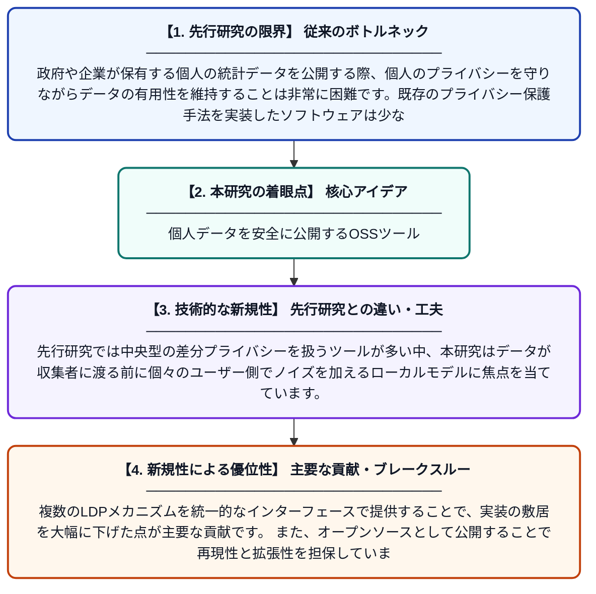

# trasgoDP: ローカル差分プライバシーに基づくノイズ付き表形式マイクロデータ公開のためのオープンソースフレームワーク

**Original Title**: *trasgoDP: An Open Source Framework for Releasing Noised Tabular Microdata under Local Differential Privacy*

> **💡 一言要約**: 個人データを安全に公開するOSSツール

| 項目 | 内容 |
|---|---|
| **著者** | JSP Díaz, ÁL García |
| **掲載誌** | arXiv preprint arXiv:2607.22230 2026 |
| **アラートキーワード** | differential privacy |
| **PDF** | [https://arxiv.org/pdf/2607.22230](https://arxiv.org/pdf/2607.22230) |
| **Git リポジトリ** | [https://github.com/IFCA-Advanced-Computing/trasgodp](https://github.com/IFCA-Advanced-Computing/trasgodp) |
| **原文リンク** | [https://arxiv.org/abs/2607.22230](https://arxiv.org/abs/2607.22230) |
| **PDF版要約** | [README.pdf](./README.pdf) |

---

## 📊 新規性の図解（先行研究との違いと本研究のブレークスルー）

## 📝 要約

本論文では、個人の統計データ（マイクロデータ）を公開する際にプライバシーを保護するためのオープンソースフレームワーク「trasgoDP」を提案しています。このフレームワークはローカル差分プライバシー（LDP）の概念に基づき、元の個人レコードにノイズを加えてプライバシーを保護した版を生成します。複数の統計アルゴリズムを実装しており、研究者や実務家が容易に利用できる設計となっています。

## ❓ どんな問題に取り組んだか

政府や企業が保有する個人の統計データを公開する際、個人のプライバシーを守りながらデータの有用性を維持することは非常に困難です。既存のプライバシー保護手法を実装したソフトウェアは少なく、研究者や実務家が差分プライバシーを手軽に活用できる環境が整っていませんでした。

## ✨ 何が新しい？何がすごい？（新規性）

trasgoDPは、ローカル差分プライバシー（LDP）に特化した表形式マイクロデータ向けのオープンソースフレームワークとして新たに設計されています。先行研究では中央型の差分プライバシーを扱うツールが多い中、本研究はデータが収集者に渡る前に個々のユーザー側でノイズを加えるローカルモデルに焦点を当てています。複数のLDPメカニズムを統一的なインターフェースで提供することで、実装の敷居を大幅に下げた点が主要な貢献です。また、オープンソースとして公開することで再現性と拡張性を担保しています。

## 🎓 大学1年生向けの解説

あなたのアンケート回答や購買履歴などの個人データは、そのまま公開されると誰がどんな行動をしたか特定されてしまいます。「差分プライバシー」とは、データにわざと小さなノイズ（ランダムな誤差）を加えることで、個人を特定できなくしながらも全体の統計的傾向は保つ技術です。trasgoDPは、このノイズを加える処理を誰でも簡単に使えるようにしたオープンソースのソフトウェアツールです。特に「ローカル」差分プライバシーでは、データが企業や政府に渡る前の段階で、あなた自身のデバイス上でノイズが加えられるので、より安全です。このツールのおかげで、研究者や開発者がプライバシーを守ったデータ公開を手軽に実現できるようになります。
