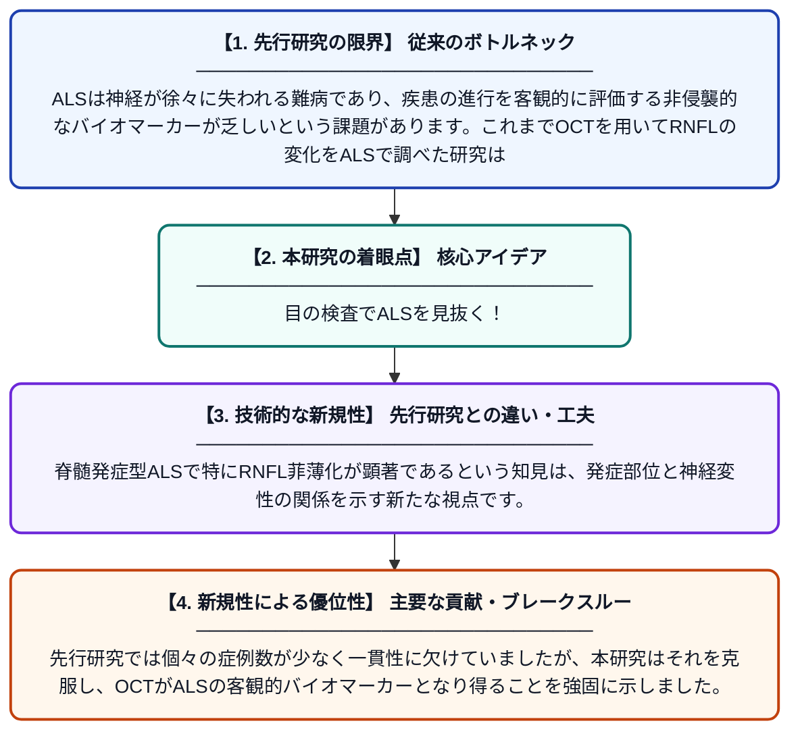

# 筋萎縮性側索硬化症（ALS）における光干渉断層計（OCT）を用いた眼科的変化の系統的レビューとメタ分析

**Original Title**: *A systematic review and meta-analysis of OCT-based ophthalmic changes in amyotrophic lateral sclerosis*

> **💡 一言要約**: 目の検査でALSを見抜く！

| 項目 | 内容 |
|---|---|
| **著者** | A Ahsan, JC Ou, P Majumder, YH Chiang, JK Huang |
| **掲載誌** | Journal of … 2026 |
| **アラートキーワード** | ALS |
| **原文リンク** | [https://www.sciencedirect.com/science/article/pii/S0165572826001773](https://www.sciencedirect.com/science/article/pii/S0165572826001773) |
| **PDF版要約** | [README.pdf](./README.pdf) |

---

## 📊 新規性の図解（先行研究との違いと本研究のブレークスルー）

## 📝 要約

本研究は、ALS患者における網膜神経線維層（RNFL）の厚さの変化をOCTで評価した複数の研究を統合・解析したメタ分析です。ALS患者では健常者と比較してRNFLが有意に菲薄化しており、特に脊髄発症型ALSでその傾向が顕著であることが示されました（SMD = −0.54）。この結果は、眼科的検査がALSの疾患進行を非侵襲的にモニタリングするバイオマーカーとなり得る可能性を示唆しています。

## ❓ どんな問題に取り組んだか

ALSは神経が徐々に失われる難病であり、疾患の進行を客観的に評価する非侵襲的なバイオマーカーが乏しいという課題があります。これまでOCTを用いてRNFLの変化をALSで調べた研究は個別に存在していましたが、それらを統合した大規模な定量的解析は不足していました。

## ✨ 何が新しい？何がすごい？（新規性）

本研究は、ALS患者のOCTによる眼科的変化を対象とした初の包括的なメタ分析であり、複数の独立した研究結果を統計的に統合することで信頼性の高いエビデンスを提供しています。脊髄発症型ALSで特にRNFL菲薄化が顕著であるという知見は、発症部位と神経変性の関係を示す新たな視点です。先行研究では個々の症例数が少なく一貫性に欠けていましたが、本研究はそれを克服し、OCTがALSの客観的バイオマーカーとなり得ることを強固に示しました。

## 🎓 大学1年生向けの解説

ALSとは、脳や脊髄の神経が徐々に壊れていく病気で、筋肉が動かせなくなります。この研究では、目の奥の網膜（カメラのフィルムのような部分）をOCTという特殊な装置で撮影することで、ALS患者の神経の変化を調べました。すると、ALS患者は健康な人に比べて網膜の神経層が薄くなっていることがわかりました。つまり、痛みのない目の検査だけで、ALSの病状の進み具合を追跡できる可能性があるということです。これは将来、より早期の診断や治療効果の確認に役立つかもしれない重要な発見です。
