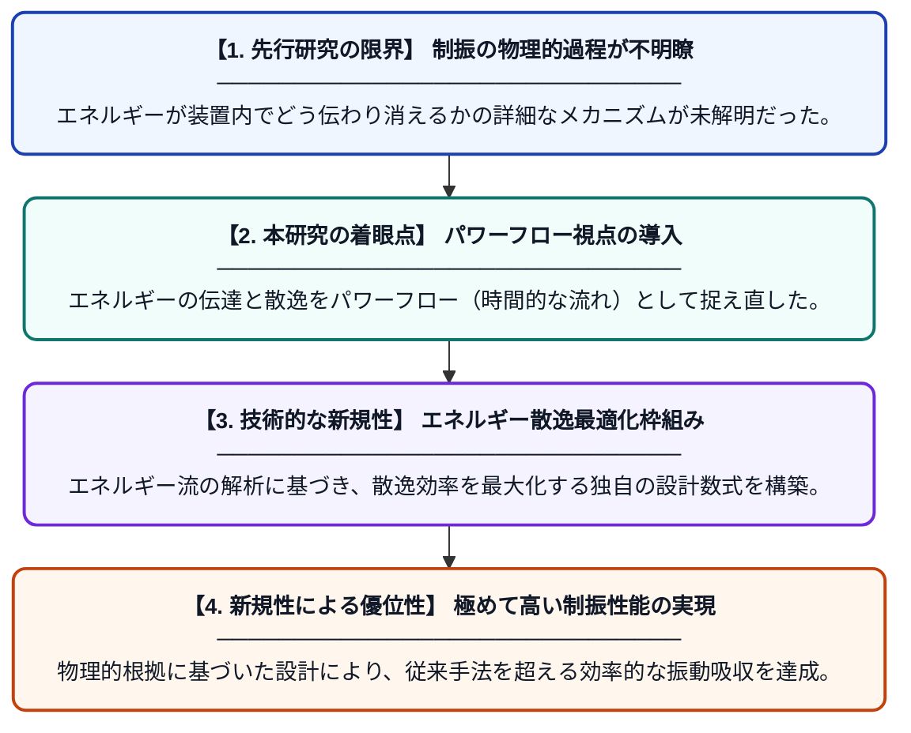

# 変異型同調質量ダンパー・イナーターのエネルギー流メカニズムとエネルギーに基づく最適化

**Original Title**: *Energy-flow mechanisms and energy-based optimization of variant-tuned mass damper inerter*

> **💡 一言要約**: エネルギーの流れを最適化し振動を抑える新技術

| 項目 | 内容 |
|---|---|
| **著者** | J Huang, Y Li, L Hao, P Tan |
| **掲載誌** | International Journal of Mechanical Sciences 2026 |
| **アラートキーワード** | optimization |
| **原文リンク** | [https://www.sciencedirect.com/science/article/pii/S0020740326011343](https://www.sciencedirect.com/science/article/pii/S0020740326011343) |
| **PDF版要約** | [README.pdf](./README.pdf) |

---

## 📊 新規性の図解（先行研究との違いと本研究のブレークスルー）

## 📝 要約

この研究は、変異型同調質量ダンパー・イナーター（V-TMDI）におけるエネルギーの伝達と散逸特性をパワーフローの観点から詳細に調査したものです。エネルギー流のメカニズムを解明することで、システムの制振性能を最大化するための新しい最適設計フレームワークを確立しました。

## ❓ どんな問題に取り組んだか

従来の制振装置の研究では、装置内部でエネルギーがどのように移動し、どこで効率的に消散されるかという詳細なプロセスが十分に解明されていませんでした。特に複雑な構造を持つV-TMDIにおいて、エネルギー散逸効率を最大化するための体系的な設計指針が不足していました。

## ✨ 何が新しい？何がすごい？（新規性）

本研究の最大の特徴は、V-TMDIを「パワーフロー」という物理的なエネルギーの流れの観点から分析し、エネルギーの移動と消失のメカニズムを可視化した点にあります。先行研究が単純な振動抑制率の向上を目指していたのに対し、エネルギー散逸の物理的根拠に基づいた最適化フレームワークを構築しました。これにより、多様な振動条件下で最も効率的にエネルギーを吸収できる設計変数を特定することが可能になりました。

## 🎓 大学1年生向けの解説

地震や風で建物が揺れるとき、その揺れのエネルギーを「おもり」や「回転する仕組み」を使って吸収する装置があります。この研究では、その装置の中でエネルギーがどのように動き、どうやって消えていくのかを、水の流れのように詳しく調べました。エネルギーが最も効率よく消えるルートを見つけることで、これまで以上に建物の揺れをピタッと止めるための最強の設計図を作れるようになりました。
