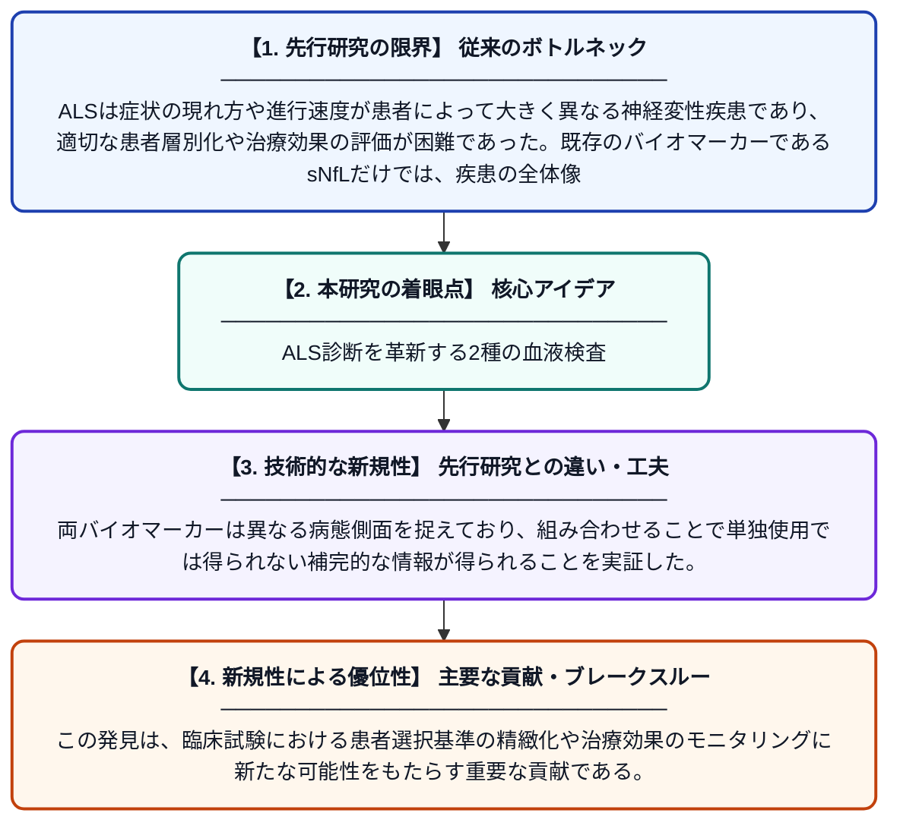

# 筋萎縮性側索硬化症における疾患蓄積と進行性の補完的バイオマーカーとしてのトロポニンTと神経フィラメント軽鎖

**Original Title**: *Troponin T and Neurofilament Light Chain Levels as Complementary Biomarkers of Disease Accumulation and Aggressiveness in Amyotrophic Lateral Sclerosis*

> **💡 一言要約**: ALS診断を革新する2種の血液検査

| 項目 | 内容 |
|---|---|
| **著者** | J Sellin, S Waldorf, J von der Gablentz, T Grehl |
| **掲載誌** | Annals of Clinical and Translational Neurology 2026 |
| **アラートキーワード** | ALS |
| **PDF** | [https://onlinelibrary.wiley.com/doi/pdf/10.1002/acn3.70499](https://onlinelibrary.wiley.com/doi/pdf/10.1002/acn3.70499) |
| **原文リンク** | [https://onlinelibrary.wiley.com/doi/pdf/10.1002/acn3.70499](https://onlinelibrary.wiley.com/doi/pdf/10.1002/acn3.70499) |
| **PDF版要約** | [README.pdf](./README.pdf) |

---

## 📊 新規性の図解（先行研究との違いと本研究のブレークスルー）

## 📝 要約

本研究は、ALS（筋萎縮性側索硬化症）患者において、血清中のトロポニンT（sTnT）と神経フィラメント軽鎖（sNfL）という2種類のバイオマーカーが互いに補完的な情報を提供することを示した。sNfLが神経細胞の破壊速度を反映する一方、sTnTは疾患の総負荷や進行の激しさを反映する可能性がある。これら2つのバイオマーカーを組み合わせることで、患者の層別化や臨床試験のデザイン改善に貢献できると示唆された。

## ❓ どんな問題に取り組んだか

ALSは症状の現れ方や進行速度が患者によって大きく異なる神経変性疾患であり、適切な患者層別化や治療効果の評価が困難であった。既存のバイオマーカーであるsNfLだけでは、疾患の全体像を十分に把握できないという限界があった。より精度の高い病態評価のために、複数のバイオマーカーを組み合わせた評価手法が必要とされていた。

## ✨ 何が新しい？何がすごい？（新規性）

これまでALS研究ではsNfLが主要なバイオマーカーとして用いられてきたが、本研究はsTnTという心筋由来のバイオマーカーがALSの疾患蓄積や進行の激しさを独立して反映することを初めて体系的に示した。両バイオマーカーは異なる病態側面を捉えており、組み合わせることで単独使用では得られない補完的な情報が得られることを実証した。この発見は、臨床試験における患者選択基準の精緻化や治療効果のモニタリングに新たな可能性をもたらす重要な貢献である。

## 🎓 大学1年生向けの解説

ALS（筋萎縮性側索硬化症）は筋肉を動かす神経が徐々に壊れていく病気で、進行の早さや症状が人によって大きく違います。この研究では、血液を調べるだけで病気の状態をより正確に把握できる2種類の「目印（バイオマーカー）」を組み合わせることが有効だとわかりました。ひとつは神経が壊れるときに出てくるタンパク質（NfL）、もうひとつは心筋や筋肉にダメージがあると増えるタンパク質（トロポニンT）です。この2つはそれぞれ違う側面から病気を教えてくれるため、両方を測ることで医師がより的確に患者さんの状態を判断できるようになります。将来的には新薬の開発や治療効果の評価にも役立つ発見です。
