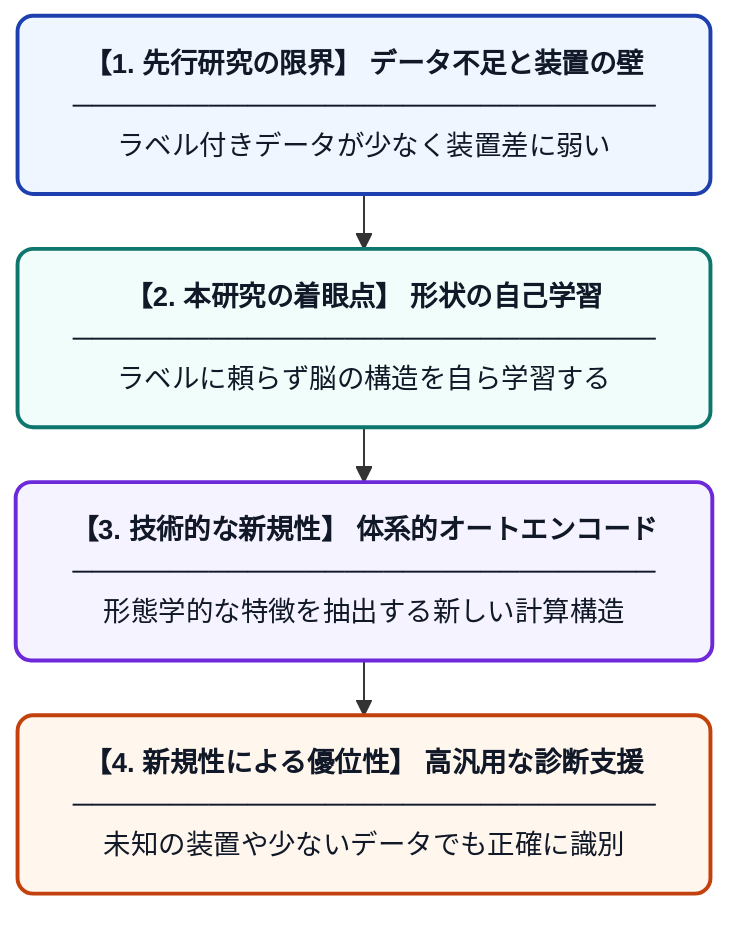

# 神経変性疾患の表現学習に向けた体系的な形態学的脳オートエンコーディング

**Original Title**: *Systematic Morphometric Brain Autoencoding for Representation Learning in Neurodegenerative Diseases*

> **💡 一言要約**: AIが脳の形状を自習し病気の兆候を見抜く

| 項目 | 内容 |
|---|---|
| **著者** | N Balbás-Esteban, A Belenguer-Llorens, E Moradi… |
| **掲載誌** | arXiv preprint arXiv … 2026 |
| **アラートキーワード** | representation learning |
| **原文リンク** | [https://arxiv.org/abs/2610.37074](https://arxiv.org/abs/2610.37074) |
| **PDF版要約** | [README.pdf](./README.pdf) |

---

## 📊 新規性の図解（先行研究との違いと本研究のブレークスルー）

## 📝 要約

脳のT1強調MRI画像から神経変性疾患を早期発見するため、ラベルなしデータから特徴を抽出する自己教師あり学習手法を提案しています。形態学的な特徴を体系的に学習するオートエンコーダーを用いることで、データの少なさや装置の違いによる精度の低下を克服しています。

## ❓ どんな問題に取り組んだか

深層学習による脳画像診断では、正解ラベル付きのデータが少ないことや、MRI装置ごとの写り方の違いが原因で、モデルが特定の環境に依存してしまい汎用性が低くなるという課題がありました。

## ✨ 何が新しい？何がすごい？（新規性）

本研究は、診断ラベルを必要としない自己教師あり学習（オートエンコーディング）を採用し、脳の構造的な特徴を系統的に捉える手法を確立しました。従来の教師あり学習とは異なり、装置間のノイズに強いロバストな特徴表現を獲得できる点が最大の特徴です。これにより、小規模なデータセットでも高い精度で神経変性疾患の識別が可能になりました。

## 🎓 大学1年生向けの解説

アルツハイマー病などの病気をAIで見つける際、一番の壁は『教科書となる正解データ』が少ないことです。この研究では、AIにいきなり病気を当てさせるのではなく、まずは大量の画像から『脳の標準的な形』を自習させました。基礎知識を身につけたAIは、装置が違っても、わずかな脳の形の変化を病気のサインとして正しく見つけ出せるようになります。
