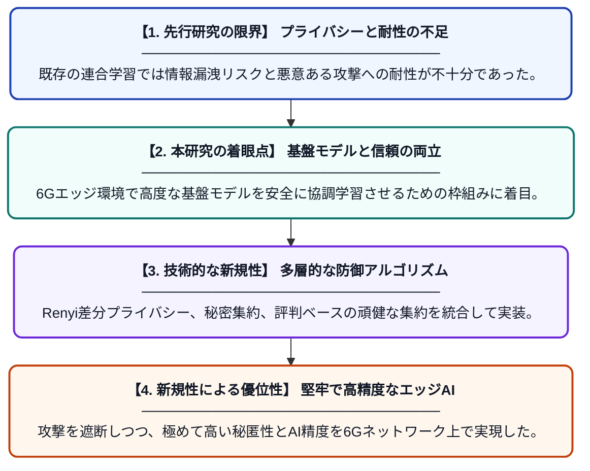

# 6Gネットワークにおけるプライバシー保護エッジインテリジェンスのための信頼性の高い連合基盤モデル

**Original Title**: *Trustworthy Federated Foundation Models for Privacy-Preserving Edge Intelligence in 6G Networks*

> **💡 一言要約**: 6G時代の安全で賢いエッジAI基盤の構築

| 項目 | 内容 |
|---|---|
| **著者** | A Shrivastava, N Al Said, S Upadhyay, N Verma… |
| **掲載誌** | IEEE World Skills … 2026 |
| **アラートキーワード** | differential privacy |
| **原文リンク** | [https://ieeexplore.ieee.org/abstract/document/11766834/](https://ieeexplore.ieee.org/abstract/document/11766834/) |
| **PDF版要約** | [README.pdf](./README.pdf) |

---

## 📊 新規性の図解（先行研究との違いと本研究のブレークスルー）

## 📝 要約

6G環境において、プライバシーを保護しつつエッジデバイス上で基盤モデルを効率的に学習させる「連合基盤モデル（FFM）」のフレームワークを提案しています。差分プライバシー、秘密集約、および評判ベースの頑健な集約アルゴリズムを組み合わせることで、攻撃に対する防御と高い秘匿性を両立させています。

## ❓ どんな問題に取り組んだか

6G通信下での膨大なデータを中央サーバーに集約することは、プライバシー漏洩や通信負荷の増大という課題があります。また、従来の連合学習では、悪意のある参加者がモデルを改ざんする攻撃や、間接的なデータ漏洩を防ぎきれないという問題がありました。

## ✨ 何が新しい？何がすごい？（新規性）

本研究は、大規模な基盤モデルをエッジ環境で連合学習させるために、Renyi差分プライバシーと秘密集約を統合した独自の保護機構を導入しました。さらに、参加者の過去の貢献度を評価する「評判重み付き集約器」を採用し、敵対的な更新を動的に排除する仕組みを構築しています。これにより、高度なAI性能の獲得と、これまでにない強固な信頼性の両立に成功しました。

## 🎓 大学1年生向けの解説

スマホなどのデバイスにある個人のデータを外に出さずに、みんなで協力して賢いAIを作る「連合学習」という技術の進化版です。6Gという次世代通信を使い、数学的な魔法（差分プライバシー）でデータが盗まれないようにガードを固めています。また、嘘の情報を送ってAIを壊そうとする悪い参加者を見抜いて無視する仕組みも備わっています。プライバシーを守りながら、世界中で安全に高度なAIを使えるようにするための研究です。
