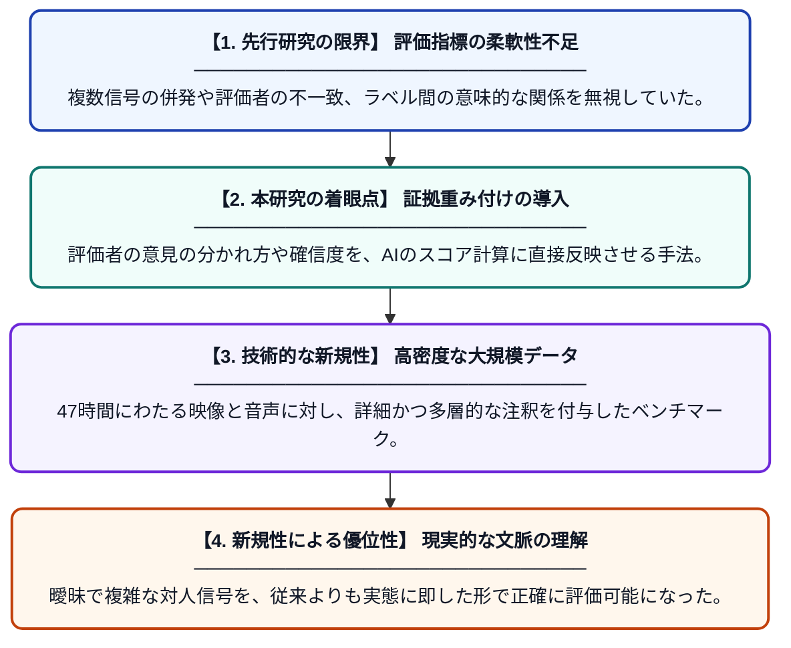

# Social Signal Bench: 映像と音声における同時発生ソーシャルシグナルの証拠重み付け評価

**Original Title**: *Social Signal Bench: Evidence-Weighted Evaluation of Co-occurring Social Signals in Video and Audio*

> **💡 一言要約**: 複合的な対人信号を正しく測る新ベンチマーク

| 項目 | 内容 |
|---|---|
| **著者** | S Ravi, AR Bargum, H Anselme, PC di Sant'Orsola… |
| **掲載誌** | arXiv preprint arXiv … 2026 |
| **アラートキーワード** | affective computing |
| **PDF** | [https://arxiv.org/pdf/2611.22704](https://arxiv.org/pdf/2611.22704) |
| **原文リンク** | [https://arxiv.org/pdf/2611.22704](https://arxiv.org/pdf/2611.22704) |
| **PDF版要約** | [README.pdf](./README.pdf) |

---

## 📊 新規性の図解（先行研究との違いと本研究のブレークスルー）

## 📝 要約

映像や音声に含まれる複数のソーシャルシグナル（表情、仕草、声のトーンなど）を同時に評価するための新しいベンチマーク「Social Signal Bench」を提案しました。従来の評価指標が無視していた、注釈者間の意見の相違やラベル間の意味的関係を考慮した、証拠重み付けによる新しい評価手法を導入しています。

## ❓ どんな問題に取り組んだか

既存の感情コンピューティングの評価手法は、複数の信号が同時に発生する場合や、評価者によって意見が分かれる曖昧なケースを適切に扱えていませんでした。また、従来の評価指標（マルチラベルF1など）はラベル同士の意味的な近さを無視するため、モデルの複雑な文脈理解を正確に測定できないという課題がありました。

## ✨ 何が新しい？何がすごい？（新規性）

47時間に及ぶ高密度なアノテーションを含む大規模データセットを構築し、複数のシグナルが重なり合う現実的な状況を評価可能にしました。最大の技術的貢献は、アノテーター間の不一致やラベル間のセマンティックな関係性をスコアに反映させる「証拠重み付け評価」の導入です。これにより、単なる正誤判定を超えて、モデルがどの程度「確信を持って人間の感覚に近い判断ができているか」を定量化できるようになりました。

## 🎓 大学1年生向けの解説

私たちが人と話すとき、笑顔でありながら少し声が震えているなど、複数のサインを同時に出しています。これまでのAIのテストは、これらを一つ一つバラバラに正解か不正解か判断するだけで、人によって受け取り方が違うという曖昧さを無視していました。この研究では、たくさんの専門家の意見のズレや、似たような意味を持つサインの関係を考慮してAIを採点する新しい仕組みを作りました。これにより、AIがどれだけ人間のように空気を読めているかをより正確に調べることができます。
