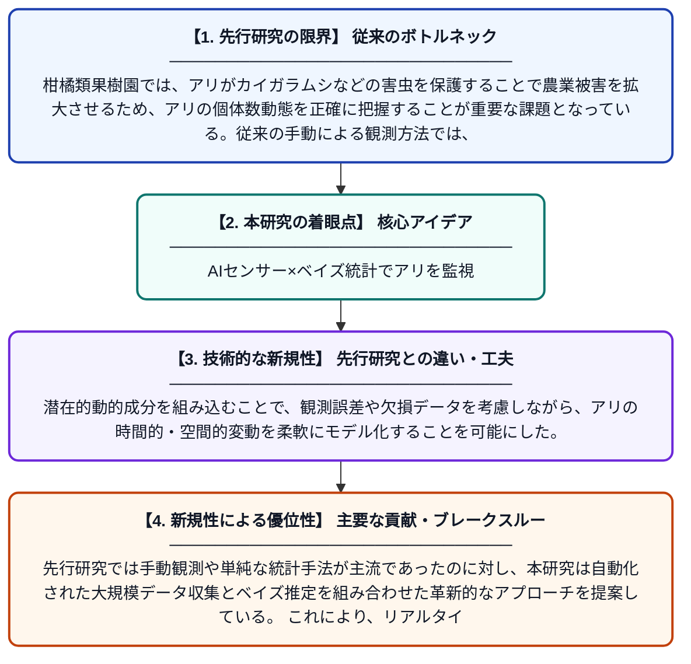

# 商業用カリフォルニア柑橘類果樹園における自動赤外線センサーで収集したアリ個体数データを解析するベイズ時空間モデルの開発

**Original Title**: *Development of Bayesian Spatiotemporal Models to Analyze Ant Count Data Collected by Automated Infrared Sensors in Commercial California Citrus Orchards*

> **💡 一言要約**: AIセンサー×ベイズ統計でアリを監視

| 項目 | 内容 |
|---|---|
| **著者** | Y Yi, I Milosavljević, MS Hoddle, Y Li |
| **掲載誌** | Journal of Agricultural, Biological and Environmental Statistics 2026 |
| **アラートキーワード** | Bayesian hierarchical ... |
| **原文リンク** | [https://link.springer.com/article/10.1007/s13253-026-00746-5](https://link.springer.com/article/10.1007/s13253-026-00746-5) |
| **PDF版要約** | [README.pdf](./README.pdf) |

---

## 📊 新規性の図解（先行研究との違いと本研究のブレークスルー）

## 📝 要約

本研究では、カリフォルニアの商業用柑橘類果樹園に設置した自動赤外線センサーで収集したアリの個体数データを解析するため、ベイズ階層時空間モデルを開発した。このモデルは潜在的な動的成分を組み込み、アリの空間的・時間的な分布パターンを統計的に捉えることができる。得られた知見は、農業害虫管理における意思決定支援に活用されることが期待される。

## ❓ どんな問題に取り組んだか

柑橘類果樹園では、アリがカイガラムシなどの害虫を保護することで農業被害を拡大させるため、アリの個体数動態を正確に把握することが重要な課題となっている。従来の手動による観測方法では、広大な農園における空間的・時間的な変動を継続的かつ詳細に捉えることが困難であった。自動センサーで得られる大量かつ複雑なカウントデータを適切に解析する統計的手法も不足していた。

## ✨ 何が新しい？何がすごい？（新規性）

本研究では、自動赤外線センサーから得られるアリの個体数カウントデータに特化したベイズ階層時空間モデルを初めて構築した点が新しい。潜在的動的成分を組み込むことで、観測誤差や欠損データを考慮しながら、アリの時間的・空間的変動を柔軟にモデル化することを可能にした。先行研究では手動観測や単純な統計手法が主流であったのに対し、本研究は自動化された大規模データ収集とベイズ推定を組み合わせた革新的なアプローチを提案している。これにより、リアルタイムに近い形での害虫監視・管理戦略の立案が現実的となった。

## 🎓 大学1年生向けの解説

柑橘類の果樹園では、アリが害虫を守ってしまうため農家にとって大きな問題です。この研究では、果樹園に赤外線センサーを設置して自動的にアリの数を数え続けるシステムを活用しました。集めたデータを「ベイズ統計」という高度な数学的手法で解析することで、アリがいつ・どこに多く現れるかを予測するモデルを作りました。これは天気予報のように、過去のデータから将来のアリの動きを予測するイメージです。この技術によって、農家はより賢くアリを管理し、農薬の使用量を減らすことが期待されています。
