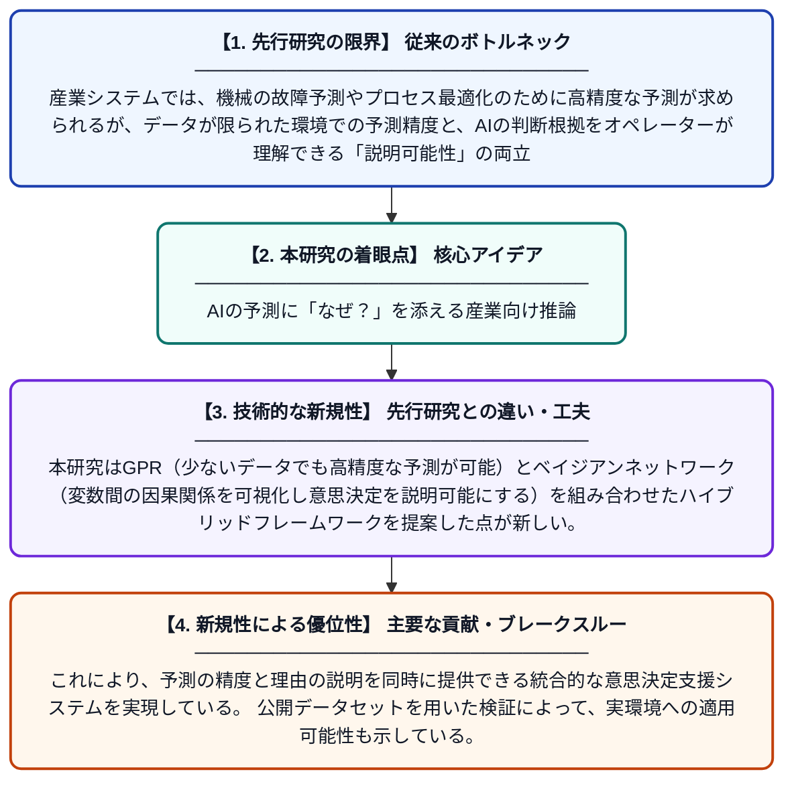

# 産業システムにおける説明可能な意思決定支援のためのガウス過程とベイジアンネットワークのハイブリッド推論

**Original Title**: *Hybrid Gaussian Process and Bayesian Network Inference for Explainable Decision Support in Industrial Systems*

> **💡 一言要約**: AIの予測に「なぜ？」を添える産業向け推論

| 項目 | 内容 |
|---|---|
| **著者** | M Proietti, F Bianchi, L Sani, A Vispa, S Speziali |
| **掲載誌** | Computing Conference 2026 |
| **アラートキーワード** | gaussian process |
| **原文リンク** | [https://link.springer.com/chapter/10.1007/978-3-032-24804-6_41](https://link.springer.com/chapter/10.1007/978-3-032-24804-6_41) |
| **PDF版要約** | [README.pdf](./README.pdf) |

---

## 📊 新規性の図解（先行研究との違いと本研究のブレークスルー）

## 📝 要約

本研究では、ガウス過程回帰（GPR）とベイジアンネットワーク（BN）という2つの確率的推論手法を組み合わせたハイブリッドアプローチを産業システムへ応用している。データが少ない状況でもGPRが精度の高い予測を提供し、BNが因果関係の可視化と説明可能な意思決定を支援する。この組み合わせにより、予測精度と解釈可能性を両立したシステムの実現を目指している。

## ❓ どんな問題に取り組んだか

産業システムでは、機械の故障予測やプロセス最適化のために高精度な予測が求められるが、データが限られた環境での予測精度と、AIの判断根拠をオペレーターが理解できる「説明可能性」の両立が大きな課題となっている。ブラックボックス的なAIモデルは精度は高くても信頼性や現場での採用が難しく、実用化の障壁となっている。

## ✨ 何が新しい？何がすごい？（新規性）

先行研究では予測精度と説明可能性はトレードオフの関係にあり、どちらか一方に特化したモデルが主流であった。本研究はGPR（少ないデータでも高精度な予測が可能）とベイジアンネットワーク（変数間の因果関係を可視化し意思決定を説明可能にする）を組み合わせたハイブリッドフレームワークを提案した点が新しい。これにより、予測の精度と理由の説明を同時に提供できる統合的な意思決定支援システムを実現している。公開データセットを用いた検証によって、実環境への適用可能性も示している。

## 🎓 大学1年生向けの解説

工場や発電所などの産業現場では、機械が壊れる前に予測したり、最適な操作を判断したりするためにAIが使われています。しかし「AIがなぜそう判断したか」がわからないと、現場の人が信頼して使えません。この研究では、少ないデータでも正確に予測できる『ガウス過程回帰』と、物事の因果関係をわかりやすく図で示す『ベイジアンネットワーク』という2つの手法を組み合わせました。これにより、「何が起きるか」を予測しながら「なぜそうなるか」も説明できるAIシステムを作ることに成功しています。
