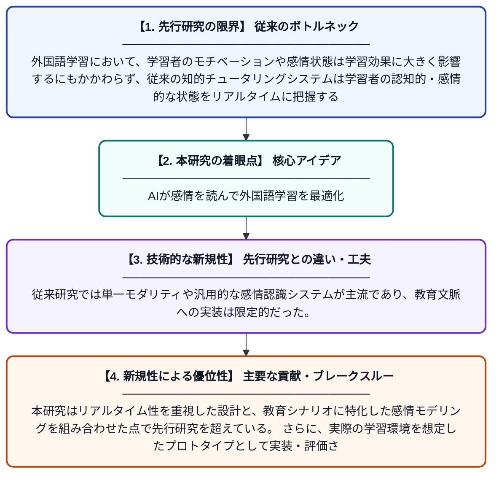

# 外国語学習のための知的チュータリングシステムにおけるマルチモーダル感情モデリング

**Original Title**: *Multimodal Affective Modelling in an Intelligent Tutoring System for Foreign Language Learning*

> **💡 一言要約**: AIが感情を読んで外国語学習を最適化

| 項目 | 内容 |
|---|---|
| **著者** | D Koulouris, A Kallipolitis, M Tziomaka, A Zafeiriou |
| **掲載誌** | Proceedings of Computational Affective … 2026 |
| **アラートキーワード** | affective computing |
| **PDF** | [https://aclanthology.org/anthology-files/anthology-files/pdf/cas/2026.cas-1.pdf#page=202](https://aclanthology.org/anthology-files/anthology-files/pdf/cas/2026.cas-1.pdf#page=202) |
| **Git リポジトリ** | [https://github.com/esohman/SoftBCE_Emotions](https://github.com/esohman/SoftBCE_Emotions) |
| **原文リンク** | [https://aclanthology.org/anthology-files/anthology-files/pdf/cas/2026.cas-1.pdf#page=202](https://aclanthology.org/anthology-files/anthology-files/pdf/cas/2026.cas-1.pdf#page=202) |
| **PDF版要約** | [README.pdf](./README.pdf) |

---

## 📊 新規性の図解（先行研究との違いと本研究のブレークスルー）

## 📝 要約

本論文は、音声・映像・生体信号など複数のモダリティを組み合わせた感情認識アーキテクチャを提案し、外国語学習を支援する知的チュータリングシステム（ITS）にリアルタイムで統合する手法を示している。学習者の感情状態をリアルタイムまたは準リアルタイムで推定することで、学習体験の個別最適化を目指す。教育現場における感情コンピューティングの実用的なプロトタイプとして、その有効性を検証している。

## ❓ どんな問題に取り組んだか

外国語学習において、学習者のモチベーションや感情状態は学習効果に大きく影響するにもかかわらず、従来の知的チュータリングシステムは学習者の認知的・感情的な状態をリアルタイムに把握する仕組みを持っていなかった。単一の入力情報だけでは感情認識の精度に限界があり、複数の生体・行動データを融合して正確に推定する技術が求められていた。

## ✨ 何が新しい？何がすごい？（新規性）

本研究の新規性は、音声・顔映像・生体信号（バイオシグナル）という異なる種類のデータを同時に活用するマルチモーダルな感情認識アーキテクチャを、外国語学習専用のITSに統合した点にある。従来研究では単一モダリティや汎用的な感情認識システムが主流であり、教育文脈への実装は限定的だった。本研究はリアルタイム性を重視した設計と、教育シナリオに特化した感情モデリングを組み合わせた点で先行研究を超えている。さらに、実際の学習環境を想定したプロトタイプとして実装・評価されている点も重要な貢献である。

## 🎓 大学1年生向けの解説

皆さんが英語や外国語を学ぶとき、退屈だったり緊張したりすることがありますよね。この研究では、カメラ・マイク・心拍センサーなどを使って学習者の「感情」をAIがリアルタイムで読み取るシステムを作りました。たとえば「この生徒は今困っているな」とAIが判断したら、教え方をやさしく変えることができます。複数のセンサーを組み合わせることで、一つだけ使うより正確に感情を推定できるのがポイントです。まるで感情を読める家庭教師がずっそばにいるようなイメージの技術です。
