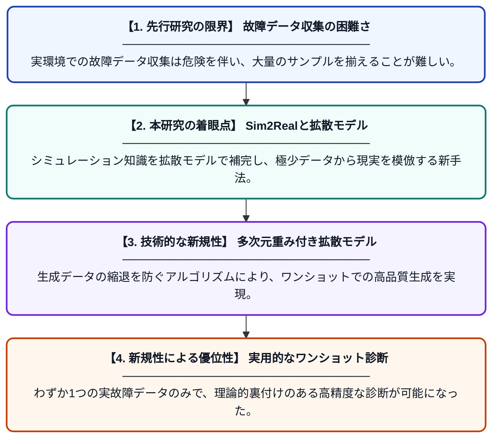

# クアッドコプターにおける少数の故障診断のための階層型Sim2Realと拡散モデル

**Original Title**: *Hierarchical Sim2Real and Diffusion for Few-Shot Fault Diagnosis in Quadcopter Systems*

> **💡 一言要約**: 1つの故障データでドローンの異常を特定

| 項目 | 内容 |
|---|---|
| **著者** | B Jin, D Tang, MAA Ismail, Q Quan |
| **掲載誌** | IEEE Transactions on Instrumentation and … 2026 |
| **アラートキーワード** | one shot |
| **原文リンク** | [https://ieeexplore.ieee.org/abstract/document/11755651/](https://ieeexplore.ieee.org/abstract/document/11755651/) |
| **PDF版要約** | [README.pdf](./README.pdf) |

---

## 📊 新規性の図解（先行研究との違いと本研究のブレークスルー）

## 📝 要約

シミュレーションから現実への知識転送（Sim2Real）と拡散モデルを組み合わせ、クアッドコプターの故障診断をわずか1つの実データ（ワンショット）で実現する手法を提案しています。多次元重み付き拡散モデルを用いることで、生成データの質を向上させ、従来困難だった極少データでの高精度な診断を可能にしました。

## ❓ どんな問題に取り組んだか

従来の機械学習を用いた故障診断では、大量の故障データが必要ですが、実際のドローンを故障させてデータを集めるのは困難かつ危険です。特に、未知の故障や稀なケースに対して、限られた実データのみで高い精度を維持することが大きな課題となっていました。

## ✨ 何が新しい？何がすごい？（新規性）

階層的なSim2Real構造と、多次元重み付き拡散モデルを導入した点が画期的です。これにより、故障タイプごとに1つの実サンプルしかない「ワンショット」設定でも、生成データが劣化（縮退）しないことを理論的に証明しつつ、高品質な学習データを生成することに成功しました。シミュレーションと実データのギャップを埋める新たな枠組みを提示しています。

## 🎓 大学1年生向けの解説

ドローンが壊れたとき、どこが故障したのかをAIに教えるには、本来たくさんの「故障したドローンのデータ」が必要です。しかし、わざとドローンを壊してデータを集めるのはお金も時間もかかります。この研究では、コンピュータ上のシミュレーションと、AIによるデータ生成技術を組み合わせることで、たった1回だけの故障例からでも、AIが正確に故障を判断できる仕組みを開発しました。
