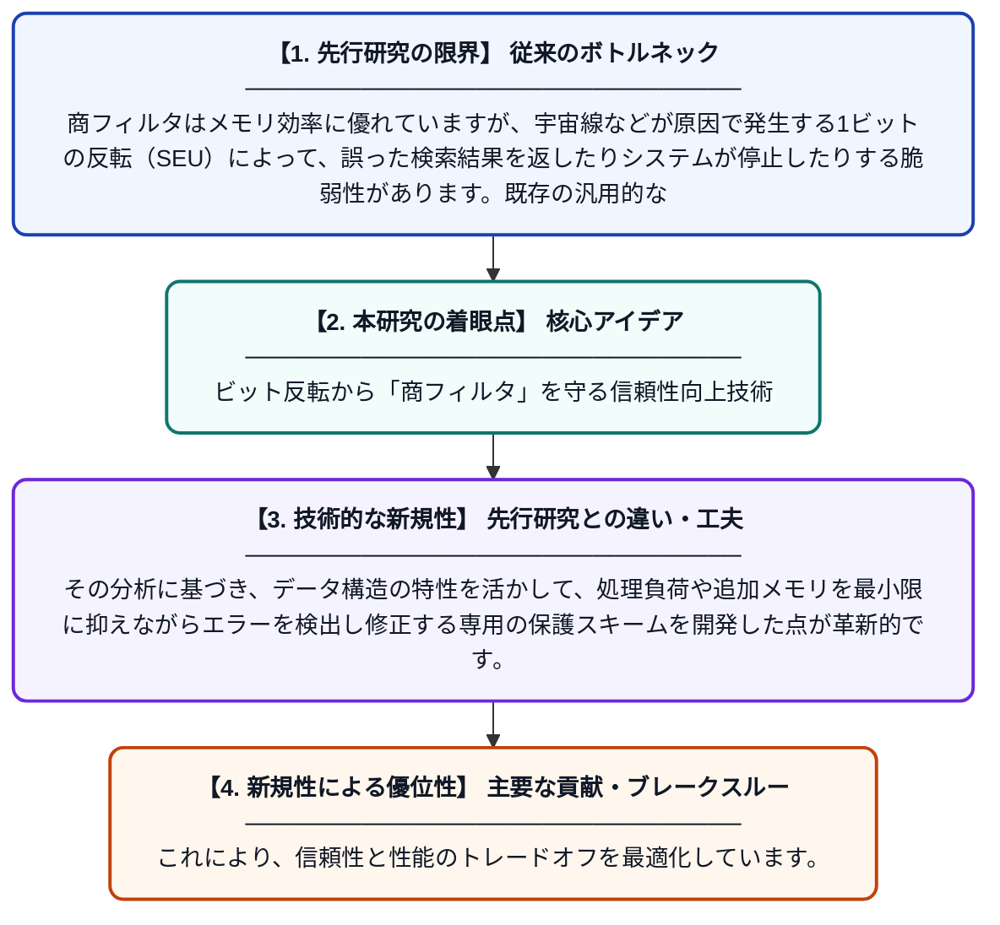

# シングルイベントアップセット（SEU）発生下における商フィルタの信頼性解析と保護手法

**Original Title**: *Dependability Analysis and Protection of Quotient Filters in the Presence of a Single Event Upset*

> **💡 一言要約**: ビット反転から「商フィルタ」を守る信頼性向上技術

| 項目 | 内容 |
|---|---|
| **著者** | J Zhu, Z Gao, P Reviriego, S Liu, F Lombardi |
| **掲載誌** | … on Dependable and Secure Computing 2026 |
| **アラートキーワード** | Secure Computing |
| **原文リンク** | [https://www.computer.org/csdl/journal/tq/5555/01/11746021/2kNpaTU8Igg](https://www.computer.org/csdl/journal/tq/5555/01/11746021/2kNpaTU8Igg) |
| **PDF版要約** | [README.pdf](./README.pdf) |

---

## 📊 新規性の図解（先行研究との違いと本研究のブレークスルー）

## 📝 要約

本論文は、メモリ上のビット反転（SEU）が、近似的メンバーシップ判定に用いられる「商フィルタ（Quotient Filter）」に与える影響を定量的に分析しています。ビットエラーによる誤判定やデータの不整合を評価した上で、計算コストを抑えつつ高い信頼性を確保するための新しい保護技術を提案しています。

## ❓ どんな問題に取り組んだか

商フィルタはメモリ効率に優れていますが、宇宙線などが原因で発生する1ビットの反転（SEU）によって、誤った検索結果を返したりシステムが停止したりする脆弱性があります。既存の汎用的な誤り訂正技術を適用すると、商フィルタの利点である高速性や低メモリ消費が損なわれるという課題がありました。

## ✨ 何が新しい？何がすごい？（新規性）

商フィルタを構成するメタデータやハッシュ値の各ビットがエラーに及ぼす影響を詳細にモデル化し、どこが最も致命的かを特定しました。その分析に基づき、データ構造の特性を活かして、処理負荷や追加メモリを最小限に抑えながらエラーを検出し修正する専用の保護スキームを開発した点が革新的です。これにより、信頼性と性能のトレードオフを最適化しています。

## 🎓 大学1年生向けの解説

コンピュータのメモリの中身は、放射線などの影響で突然「0」が「1」に書き換わってしまうことがあります。この論文では、データが「ある」か「ない」かを高速に判定する『商フィルタ』という仕組みが、その書き換えによってどれくらい壊れやすいかを調査しました。そして、もし間違いが起きても自動で検知して直すための、賢くて効率的な守り方を提案しています。これにより、宇宙空間や重要なサーバーなど、絶対にミスが許されない環境でも安心して商フィルタを使えるようになります。
