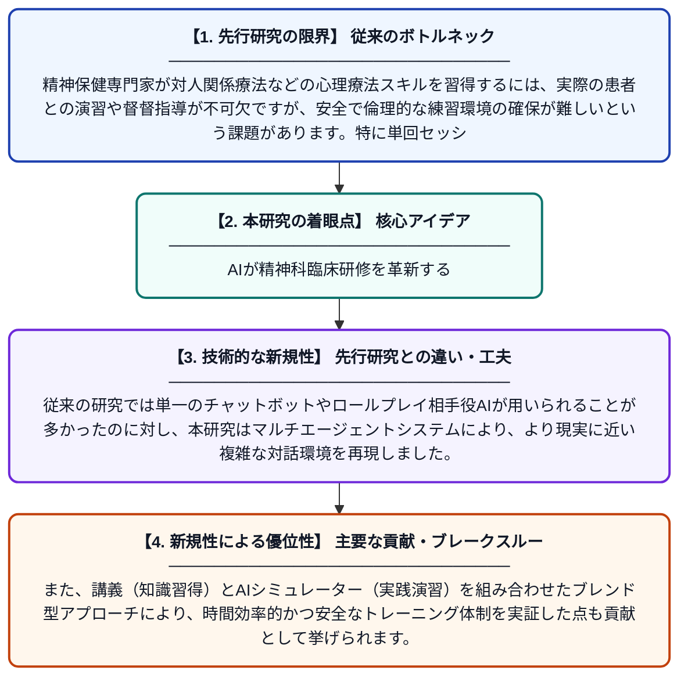

# マルチエージェントAIシミュレーターを用いた単回セッション対人関係療法における精神保健専門家のトレーニング：事前事後概念実証研究

**Original Title**: *Training Mental Health Professionals in Single-Session IPT with a Multi-Agent AI Simulator: A Pre–Post Proof-of-Concept Study*

> **💡 一言要約**: AIが精神科臨床研修を革新する

| 項目 | 内容 |
|---|---|
| **著者** | Z Elyoseph, A Klein-Rafaeli, N Beiman, AC Sweetland |
| **掲載誌** | Computers in Human Behavior 2026 |
| **アラートキーワード** | multi agent |
| **原文リンク** | [https://www.sciencedirect.com/science/article/pii/S2949882126001179](https://www.sciencedirect.com/science/article/pii/S2949882126001179) |
| **PDF版要約** | [README.pdf](./README.pdf) |

---

## 📊 新規性の図解（先行研究との違いと本研究のブレークスルー）

## 📝 要約

本研究は、単回セッション対人関係療法（IPT-SSI）の簡易ブレンド型トレーニングプログラムを開発・評価したものです。講義形式のワークショップの後に、マルチエージェントAIシミュレーターを用いた実践演習を組み合わせた混合研究デザインを採用しています。事前事後比較によって、このプログラムの有効性の概念実証を試みました。

## ❓ どんな問題に取り組んだか

精神保健専門家が対人関係療法などの心理療法スキルを習得するには、実際の患者との演習や督督指導が不可欠ですが、安全で倫理的な練習環境の確保が難しいという課題があります。特に単回セッションという短期介入では、限られた時間内に高度なスキルを発揮する必要があり、従来の研修方法だけでは十分な準備が困難でした。

## ✨ 何が新しい？何がすごい？（新規性）

本研究の最大の新規性は、複数のAIエージェントが連携するシミュレーターを精神療法トレーニングに活用した点です。従来の研究では単一のチャットボットやロールプレイ相手役AIが用いられることが多かったのに対し、本研究はマルチエージェントシステムにより、より現実に近い複雑な対話環境を再現しました。また、講義（知識習得）とAIシミュレーター（実践演習）を組み合わせたブレンド型アプローチにより、時間効率的かつ安全なトレーニング体制を実証した点も貢献として挙げられます。

## 🎓 大学1年生向けの解説

精神科のカウンセラーなどの専門家が心理療法のスキルを練習するとき、実際の患者さんを使って練習するのは難しいですよね。この研究では、AIが患者役を演じてくれるシミュレーターを開発して、専門家が安全に練習できる仕組みを作りました。しかも複数のAIが協力して動く「マルチエージェント」という仕組みにより、よりリアルな会話練習ができます。まず授業で知識を学んだあと、このAIシミュレーターで実践練習するという流れが、効果的なトレーニングにつながることを実験で確かめました。
