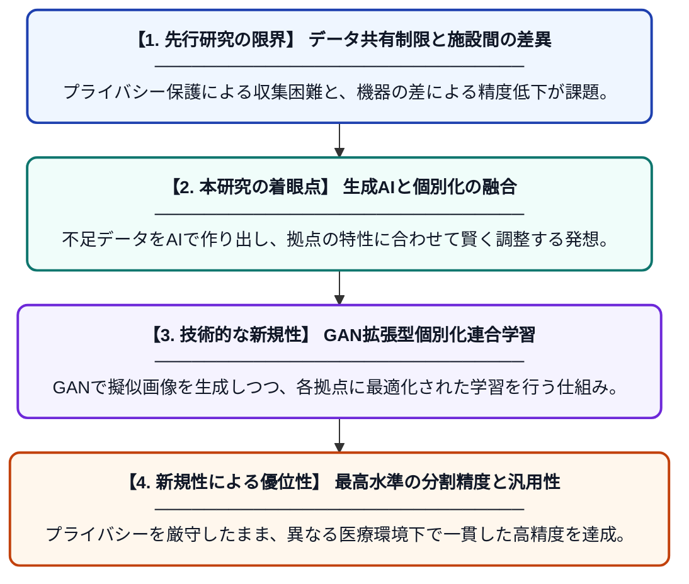

# GAP-FedPolyp：頑健な大腸ポリープ分割のためのGAN拡張および個別化連合学習

**Original Title**: *GAP-FedPolyp: GAN-Augmented and Personalized Federated Learning for Robust Colorectal Polyp Segmentation*

> **💡 一言要約**: プライバシーを守り、AIで大腸ポリープを正確に発見

| 項目 | 内容 |
|---|---|
| **著者** | A Raheem, Z Yang, MA Manan, S Ahmed |
| **掲載誌** | IEEE Transactions on Emerging Topics in … 2026 |
| **アラートキーワード** | Federated Learning |
| **原文リンク** | [https://ieeexplore.ieee.org/abstract/document/11806132/](https://ieeexplore.ieee.org/abstract/document/11806132/) |
| **PDF版要約** | [README.pdf](./README.pdf) |

---

## 📊 新規性の図解（先行研究との違いと本研究のブレークスルー）

## 📝 要約

患者のプライバシーを保護しつつ、複数の医療機関で協力して大腸ポリープの検出精度を高める連合学習フレームワーク「GAP-FedPolyp」を提案しました。GANを用いたデータ拡張とモデルの個別化を組み合わせることで、施設ごとのデータの質や量の違いを克服しています。

## ❓ どんな問題に取り組んだか

医療データは機密性が高く、複数の病院間で画像データを直接共有してAIを訓練することが困難です。また、病院ごとに内視鏡の機種や症例の偏りがあるため、一つの共通モデルでは特定の環境で精度が低下するという課題がありました。

## ✨ 何が新しい？何がすごい？（新規性）

GAN（敵対的生成ネットワーク）を連合学習に組み込み、各拠点での不足データを高品質に補完する仕組みを導入しました。さらに、全拠点の知識を共有するだけでなく、各拠点の特性に合わせてモデルを最適化する「個別化手法」を採用しています。これにより、データが少ない施設でも、他施設の知見を活かしつつ自施設の環境に最適な診断モデルを構築できる点が画期的です。

## 🎓 大学1年生向けの解説

病院にある患者さんの画像データは、外に持ち出すことが法律などで厳しく制限されています。そこで、データは病院に置いたまま、AIの「学習した成果」だけを通信して賢くする「連合学習」という技術を使います。この研究では、さらにAIに練習用の画像を生成させたり、病院ごとの機械の違いに合わせてAIを微調整したりする工夫を加えました。その結果、情報の秘密を守りながら、大腸がんの元になるポリープを非常に正確に見つけられるようになりました。
