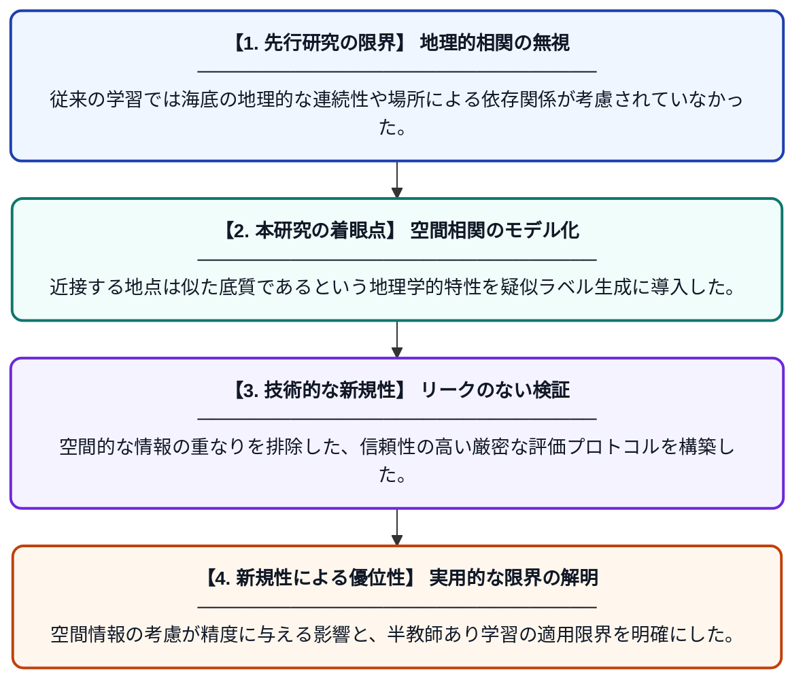

# 地理空間的相関を考慮した半教師あり海底底質分類のための疑似ラベル取得

**Original Title**: *Pseudo-Labels Acquisition for Semi-Supervised Seafloor Substrate Classification with Consideration of Geospatial Correlation*

> **💡 一言要約**: 地理空間の相関で海底底質を賢く分類する新手法

| 項目 | 内容 |
|---|---|
| **著者** | X Shang, Z Zhang, L Dong, P Yuan |
| **掲載誌** | Journal of Marine Science and Engineering 2026 |
| **アラートキーワード** | Semi supervise |
| **原文リンク** | [https://www.mdpi.com/2077-1312/14/22/2208](https://www.mdpi.com/2077-1312/14/22/2208) |
| **PDF版要約** | [README.pdf](./README.pdf) |

---

## 📊 新規性の図解（先行研究との違いと本研究のブレークスルー）

## 📝 要約

海底底質の分類において、地理空間的なデータの相関性を考慮した新しい半教師あり学習手法を提案しています。ラベルなしデータから疑似ラベルを生成して学習に活用する際、空間的な依存関係を組み込むことで精度の向上を試みています。

## ❓ どんな問題に取り組んだか

海底底質の調査はコストが高く、正解ラベルの付いたデータが極めて少ないという課題があります。また、既存の学習モデルは地理的な位置関係によるデータの偏りや相関を十分に考慮できておらず、実環境での精度が安定しませんでした。

## ✨ 何が新しい？何がすごい？（新規性）

本研究は、海底の地理空間的な相関関係を疑似ラベルの取得プロセスに直接組み込んだ点が革新的です。先行研究では無視されがちだった「近接する地点は似た底質を持つ」という空間依存性をアルゴリズムに反映させました。さらに、データリーク（情報の漏洩）を防ぐ厳密な検証手法を用いて、半教師あり学習が必ずしも強固な教師あり学習を常に上回るわけではないという実用上の知見も提供しています。

## 🎓 大学1年生向けの解説

海の底が砂なのか岩なのかをAIで判断させる研究です。海底を調べるのは大変なので、AIには「正解が分かっている少しのデータ」と「正解が分からない大量のデータ」の両方を使って学習させます。このとき、「近くの場所は似たような底質であるはずだ」という場所のつながりをAIに教えるのがこの研究の工夫です。ただし、この方法でも、最初から正解が揃っている完璧な学習方法に勝つのは難しいことも分かりました。
