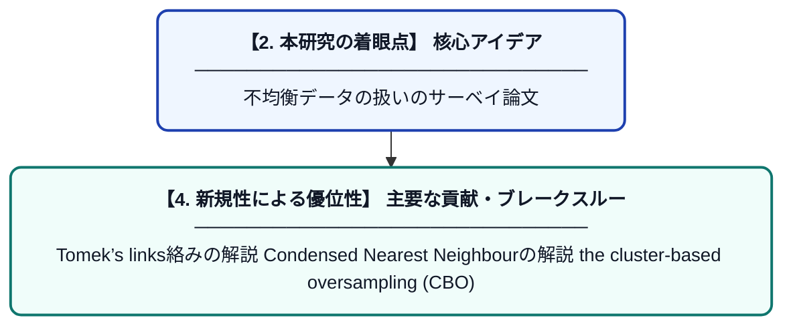

# A Survey of Predictive Modelling under Imbalanced Distributions

> **💡 一言要約**: 不均衡データの扱いのサーベイ論文

| 項目 | 内容 |
|---|---|
| **PDF版要約** | [README.pdf](./README.pdf) |

---

## 📊 新規性の図解（先行研究との違いと本研究のブレークスルー）

## 📝 要約

Tomek’s links絡みの解説

Condensed Nearest Neighbourの解説

the cluster-based oversampling (CBO)

の説明

分類問題の評価指標

accuracy

recall

precision

F1

F_beta

G- mean

ROC

AUC

PR curve

dominance

IBA

optimized precision

adjusted geometric mean

H-measure

B42

まだまだ他にもたくさんある。

バランスド正解率とか。

回帰問題の評価指標

MSE

MAD

LIN-LIN

QUAD-EXP

その他まだまだ

We propose that the existing approaches to learn under imbalanced data distributions can be grouped into the following four main categories:

Data Pre-processing

Special-purpose Learning Methods

Prediction Post-processing;

Hybrid Methods.

re-sampling:

active learning:

weighting the data space:

Ramdom under sample

アンサンブル学習の文脈でよく使われる。

ブースティング、バギングなどと統合されることもある。

Balanced Random Forest

Random under-sampling was also used in the context of ensembles.
Namely, it was combined with boosting (Seiffert et al., 2010), bagging (Wang and Yao, 2009; Chang et al., 2003; Tao et al., 2006) and was applied to both classes in random forests in a method named Balanced Random Forest
(BRF) (Chen et al., 2004).

Random samplingは大きなデータセットを扱うときには計算コストが高いのが一つのデメリットである。

データクリーニングをした後に使われる。

主な目的は、ノイズとなっているデータや境界領域にあるデータを可能な限り特定し、それを取り除くこと。

Tomek’s links

曖昧な境界を取り除く

Condensed Nearest Neighbour

色々やり方はあるが、

少数派のサンプルを全て初期値に加える。(S)

多数派のサンプルから1-NNにしたがって分類、誤分類されたら、Sに追加する。

Sに追加するデータがなくなったら終了。

One-Sided-Selection (OSS) // Tomek’s links と Condensed Nearest Neighbour

を組み合わせた手法

One-class learning

特定のクラスのみを学習する。

類似度計算するのがスタート

閾値のチューニングが厄介。

閾値を狭く設定しすぎると、少数派が排除されるし、

広く設定しすぎると、多数派が紛れ込んでしまう。

しかも普通はより多くのクラスの学習をさせたい

one-class SVMs

正常データのみから学習する、教師なし学習

正常データが、識別平面に対して原点の向こう側になるように識別平面を決める。

auto encoder
