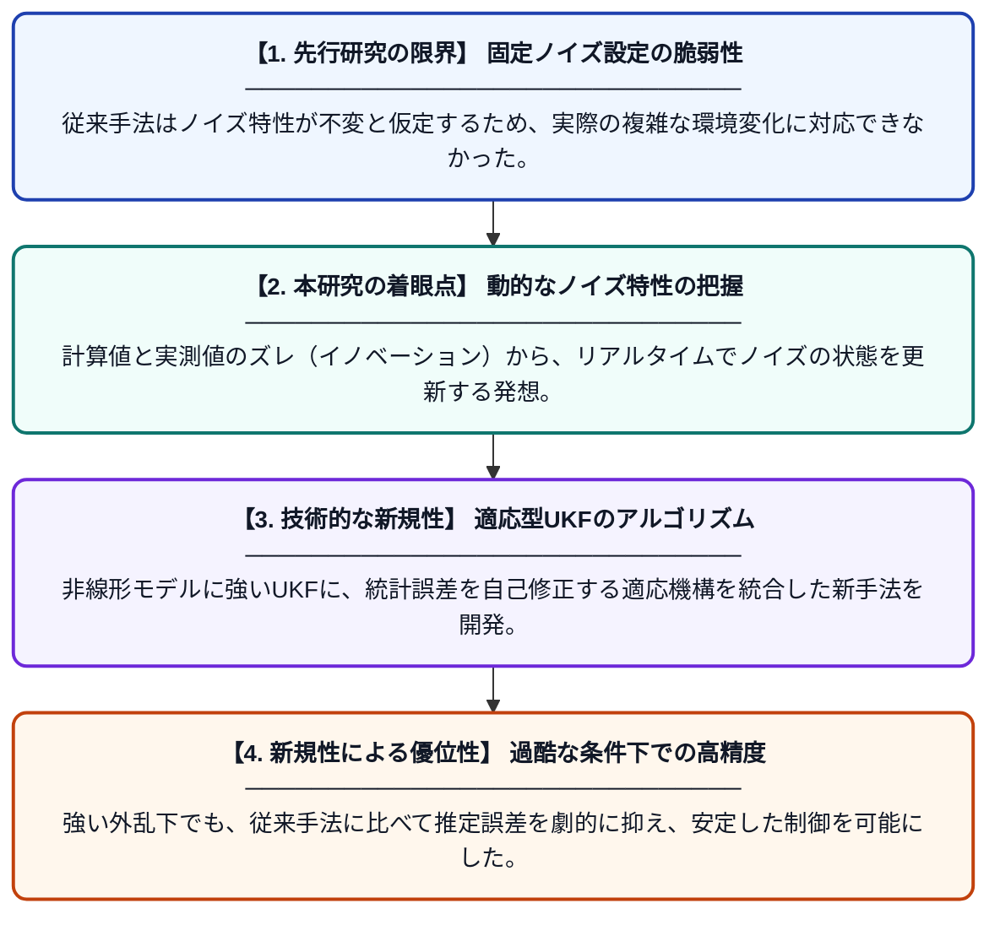

# バッチ冷却晶析における測定変数選択の影響分析を伴う、適応型無香料カルマンフィルタに基づく堅牢な状態観測器の設計

**Original Title**: *Robust state observer design based on adaptive unscented Kalman Filter with impact analysis of measurable variable selection for batch cooling crystallization …*

> **💡 一言要約**: 進化したカルマンフィルタで晶析のノイズを克服

| 項目 | 内容 |
|---|---|
| **著者** | B Shan, Z Diao, Z Li, T Zhao, Q Xu, F Zhang |
| **掲載誌** | Chemical Engineering Research and … 2026 |
| **アラートキーワード** | kalman filter |
| **原文リンク** | [https://www.sciencedirect.com/science/article/pii/S0263876226007653](https://www.sciencedirect.com/science/article/pii/S0263876226007653) |
| **PDF版要約** | [README.pdf](./README.pdf) |

---

## 📊 新規性の図解（先行研究との違いと本研究のブレークスルー）

## 📝 要約

本研究では、バッチ冷却晶析プロセスの内部状態を正確に把握するため、ノイズに強い「適応型無香料カルマンフィルタ（AUKF）」を開発しました。イノベーションベースの手法を導入することで、従来のフィルタでは困難だった複雑なノイズ環境下での推定精度を大幅に向上させています。

## ❓ どんな問題に取り組んだか

化学製品の品質を決める晶析工程では、溶液内の濃度や粒径分布をリアルタイムで把握する必要があります。しかし、センサーから得られるデータには多くのノイズが含まれており、従来の推定手法では外部の妨害や誤差の影響を強く受けてしまうことが課題でした。

## ✨ 何が新しい？何がすごい？（新規性）

従来の無香料カルマンフィルタ（UKF）に対し、誤差の統計情報をリアルタイムで更新する適応機能を組み込んだ点が画期的です。先行研究では固定されていたノイズパラメータを動的に調整することで、予測精度の安定化を実現しました。さらに、どの測定変数を組み合わせるべきかという選択が推定精度に与える影響を、影響分析を通じて初めて明確にしました。

## 🎓 大学1年生向けの解説

液体から綺麗な結晶を作る「晶析」は非常に繊細な作業で、中の様子を正確に知ることが欠かせません。しかし、工場での計測には必ず「ノイズ」という邪魔なデータ混じりが生じてしまいます。この研究では、数学的な工夫を用いてノイズの中から本物のデータだけを賢く抽出する新しい計算方法を開発しました。これにより、どんなに環境が変化しても、結晶が今どうなっているかを正確に突き止めることができます。
