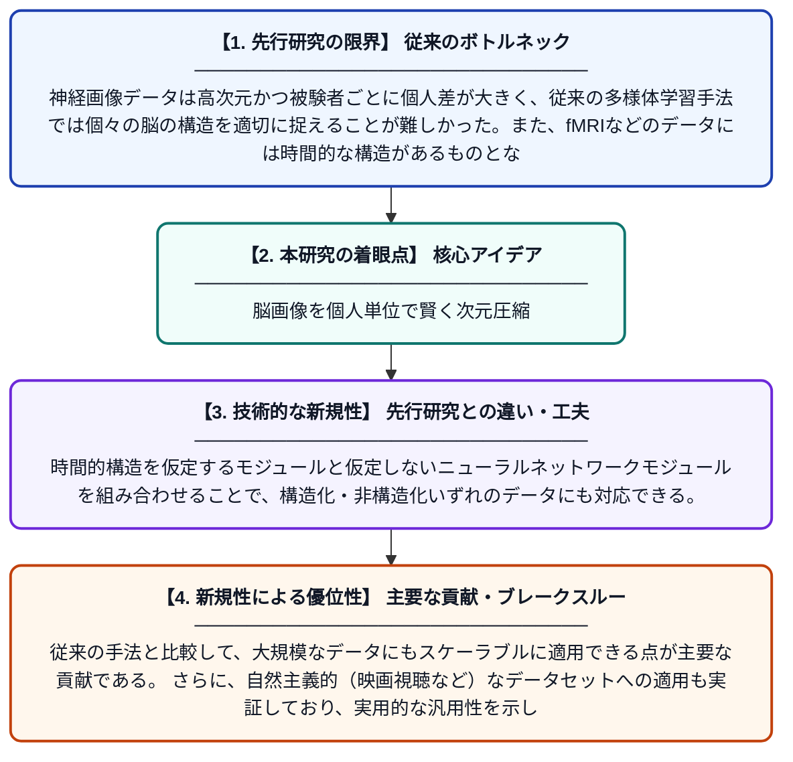

# 神経画像データのためのスケーラブルな被験者固有多様体学習フレームワーク

**Original Title**: *A scalable subject-specific manifold learning framework for neuroimaging data*

> **💡 一言要約**: 脳画像を個人単位で賢く次元圧縮

| 項目 | 内容 |
|---|---|
| **著者** | E Geenjaar, T Adalı, S Meda, G Pearlson, S Plis |
| **掲載誌** | Communications Biology 2026 |
| **アラートキーワード** | manifold learning |
| **PDF** | [https://www.nature.com/articles/s42003-026-10666-2_reference.pdf](https://www.nature.com/articles/s42003-026-10666-2_reference.pdf) |
| **Git リポジトリ** | [https://github.com/eloygeenjaar/723](https://github.com/eloygeenjaar/723) |
| **原文リンク** | [https://www.nature.com/articles/s42003-026-10666-2_reference.pdf](https://www.nature.com/articles/s42003-026-10666-2_reference.pdf) |
| **PDF版要約** | [README.pdf](./README.pdf) |

---

## 📊 新規性の図解（先行研究との違いと本研究のブレークスルー）

## 📝 要約

本論文は、脳の神経画像データを解析するために、個々の被験者に特化したスケーラブルな多様体学習フレームワークを提案している。時間的構造がある場合もない場合も対応できるよう、ニューラルネットワークを活用したモジュール設計を採用している。これにより、自然主義的な実験データを含む多様な神経画像データへの適用が可能となった。

## ❓ どんな問題に取り組んだか

神経画像データは高次元かつ被験者ごとに個人差が大きく、従来の多様体学習手法では個々の脳の構造を適切に捉えることが難しかった。また、fMRIなどのデータには時間的な構造があるものとないものが混在しており、汎用的な解析フレームワークが不足していた。

## ✨ 何が新しい？何がすごい？（新規性）

本研究は、被験者ごとの固有の脳活動パターンを反映した「被験者固有」の多様体学習モジュールを設計した点が新しい。時間的構造を仮定するモジュールと仮定しないニューラルネットワークモジュールを組み合わせることで、構造化・非構造化いずれのデータにも対応できる。従来の手法と比較して、大規模なデータにもスケーラブルに適用できる点が主要な貢献である。さらに、自然主義的（映画視聴など）なデータセットへの適用も実証しており、実用的な汎用性を示している。

## 🎓 大学1年生向けの解説

脳のMRI画像は非常に複雑で膨大なデータです。この研究は、そのデータをコンピュータが扱いやすいシンプルな形に「圧縮」する新しい方法を作りました。しかも、人によって脳の働き方は異なるため、一人ひとりに合わせた形で圧縮できる仕組みになっています。映画を見ているときの脳活動など、日常に近い状況のデータにも対応できます。これにより、脳の病気の研究や脳科学の理解がより深まることが期待されます。
