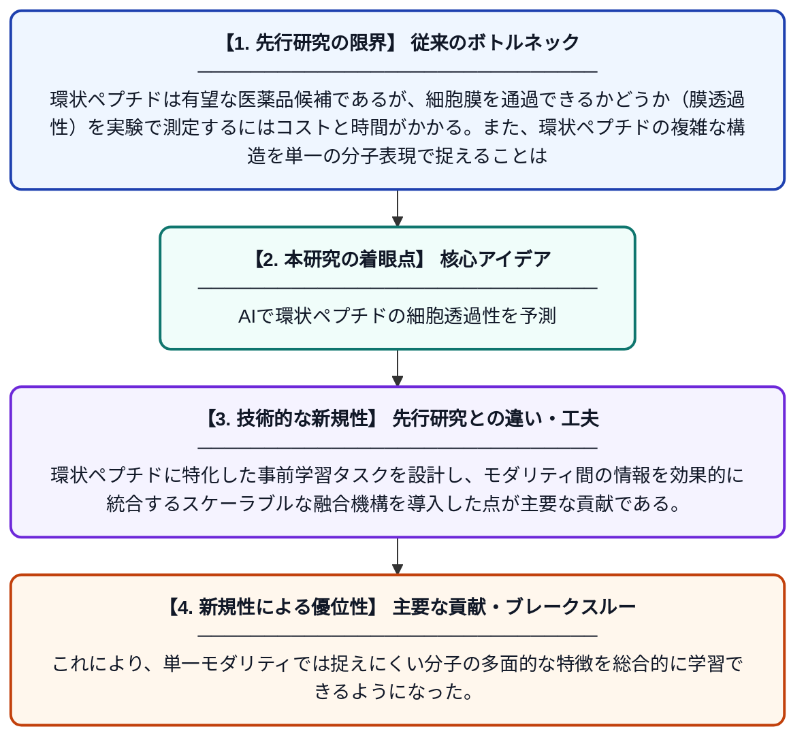

# 膜透過性予測のためのマルチモーダル環状ペプチド表現学習フレームワーク

**Original Title**: *A Multi-Modal Cyclic Peptide Representation Learning Framework for Membrane Permeability Prediction*

> **💡 一言要約**: AIで環状ペプチドの細胞透過性を予測

| 項目 | 内容 |
|---|---|
| **著者** | H Chen, X Chao, W Ou, X Fu, H Xiang, X Zeng |
| **掲載誌** | IEEE Journal of Biomedical and Health Informatics 2026 |
| **アラートキーワード** | representation learning |
| **原文リンク** | [https://ieeexplore.ieee.org/abstract/document/11627975/](https://ieeexplore.ieee.org/abstract/document/11627975/) |
| **PDF版要約** | [README.pdf](./README.pdf) |

---

## 📊 新規性の図解（先行研究との違いと本研究のブレークスルー）

## 📝 要約

本論文では、環状ペプチドの膜透過性を予測するためのマルチモーダル学習フレームワーク「MultiMol」を提案している。MultiMolは、複数の分子表現モダリティを統合するための専用事前学習タスクとスケーラブルな融合機構を組み合わせることで、表現学習と情報統合を強化する。実験結果では、MultiMolが既存手法を一貫して上回る性能を示した。

## ❓ どんな問題に取り組んだか

環状ペプチドは有望な医薬品候補であるが、細胞膜を通過できるかどうか（膜透過性）を実験で測定するにはコストと時間がかかる。また、環状ペプチドの複雑な構造を単一の分子表現で捉えることは難しく、従来の計算予測手法では精度に限界があった。

## ✨ 何が新しい？何がすごい？（新規性）

先行研究が単一モダリティの分子表現に依存していたのに対し、MultiMolは複数の異なる分子表現（グラフ・配列・3D構造など）を組み合わせるマルチモーダルアプローチを採用している。環状ペプチドに特化した事前学習タスクを設計し、モダリティ間の情報を効果的に統合するスケーラブルな融合機構を導入した点が主要な貢献である。これにより、単一モダリティでは捉えにくい分子の多面的な特徴を総合的に学習できるようになった。

## 🎓 大学1年生向けの解説

薬を体内の目的の場所に届けるためには、薬の分子が細胞の膜を通り抜けられるかどうかがとても重要です。環状ペプチドという特殊な形の分子を薬として使いたいのですが、膜を通れるかを実験で確かめるには時間もお金もかかります。そこでこの研究では、分子の構造を複数の異なる方法で同時にAIに学ばせることで、実験なしに膜透過性を高精度で予測できるシステムを作りました。ちょうど、同じ物体を正面・横・上から同時に見ることでより正確に形を把握するようなイメージです。
