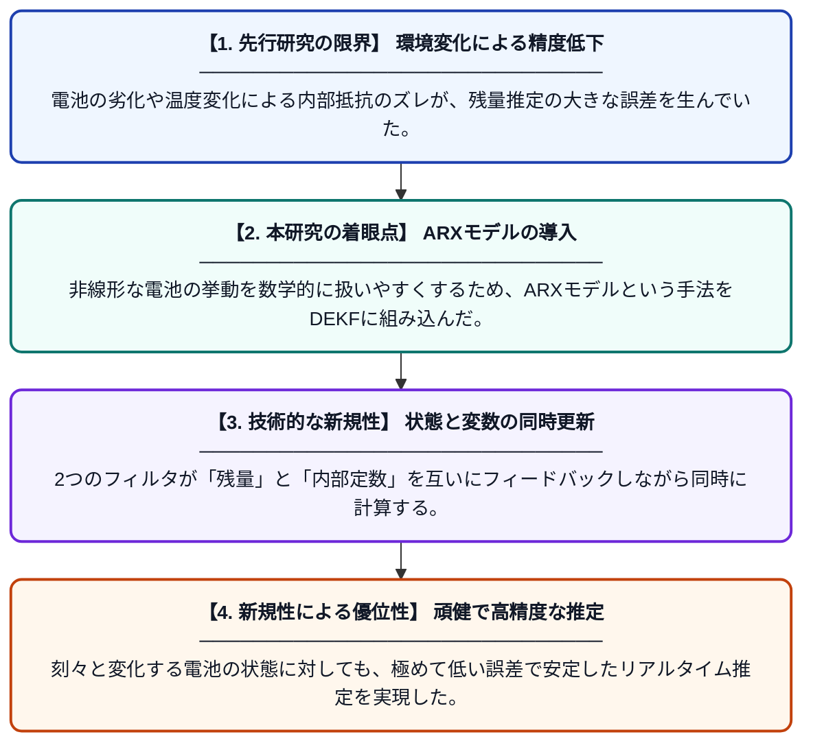

# リチウムイオン電池の充電状態とパラメータを同時推定するデュアル拡張カルマンフィルタ手法

**Original Title**: *Dual Extended Kalman Filter-Based Co-Estimation of State of Charge and Parameters for Lithium-Ion Batteries*

> **💡 一言要約**: 電池の残量と内部状態を同時に、正確にリアルタイム推定

| 項目 | 内容 |
|---|---|
| **著者** | M Taghavikoutenaei, C Gómez-Aleixandre… |
| **掲載誌** | Energy Conversion … 2026 |
| **アラートキーワード** | kalman filter |
| **原文リンク** | [https://ieeexplore.ieee.org/abstract/document/11738060/](https://ieeexplore.ieee.org/abstract/document/11738060/) |
| **PDF版要約** | [README.pdf](./README.pdf) |

---

## 📊 新規性の図解（先行研究との違いと本研究のブレークスルー）

## 📝 要約

リチウムイオン電池の充電状態（SOC）と内部パラメータをリアルタイムで同時に推定する「デュアル拡張カルマンフィルタ（DEKF）」フレームワークを提案しています。非線形で時間とともに特性が変化する電池システムに対し、ARXモデルを導入することで計算の効率化と精度の向上を両立させました。

## ❓ どんな問題に取り組んだか

従来の電池状態推定法では、電池の劣化や環境変化による内部パラメータの変動を十分に考慮できず、SOCの推定精度が低下する課題がありました。また、電池の複雑な非線形挙動を計算負荷を抑えながら正確にモデル化することも困難でした。

## ✨ 何が新しい？何がすごい？（新規性）

本研究の新規性は、DEKFフレームワークに外部入力を持つ自己回帰（ARX）モデルを統合した点にあります。これにより、電池の物理的特性を効率的に表現し、状態量とパラメータを相互に補正しながら同時に更新することが可能になりました。先行研究と比較して、時変システムに対する適応能力が非常に高く、推定誤差を大幅に削減することに成功しています。

## 🎓 大学1年生向けの解説

電気自動車やスマホの電池の「残りあと何％」という表示を、より正確にするための新しい計算方法の研究です。電池は使っていくうちに性能が少しずつ変わるため、残量を当てるのは実はとても難しいことです。この研究では、2つの予測エンジンを同時に動かすような仕組みを使い、電池の今の「健康状態」と「残りカス」を同時にピタリと当てる魔法のようなアルゴリズムを作りました。
