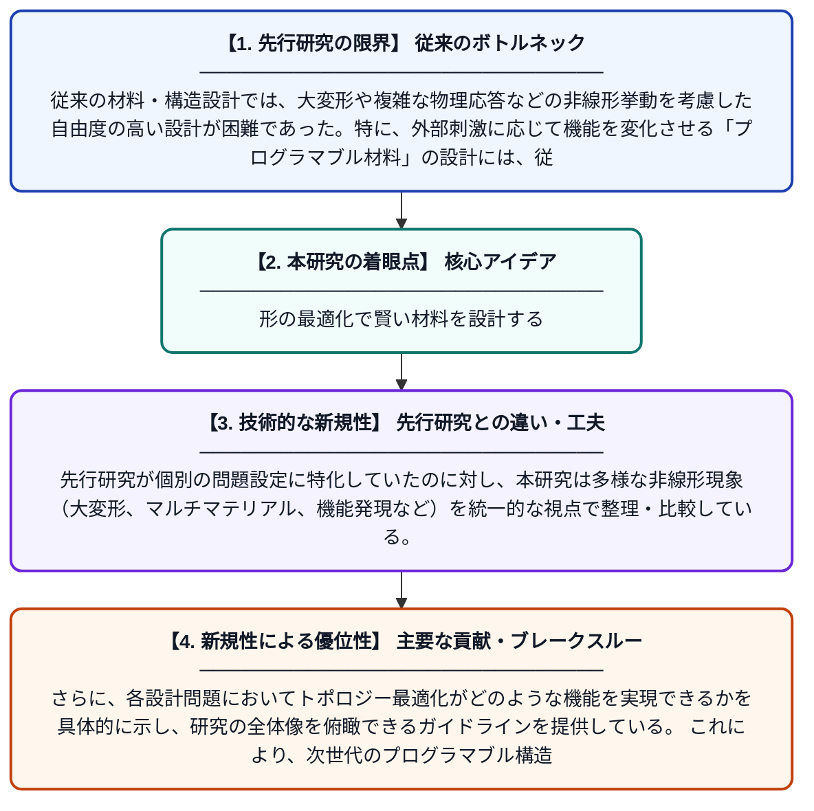

# 非線形挙動を持つプログラマブル材料・構造のためのトポロジー最適化

**Original Title**: *Topology optimization for programmable materials and structures with nonlinear behaviors*

> **💡 一言要約**: 形の最適化で賢い材料を設計する

| 項目 | 内容 |
|---|---|
| **著者** | W Li, X Zhao, XS Zhang |
| **掲載誌** | Extreme Mechanics Letters 2026 |
| **アラートキーワード** | optimization |
| **原文リンク** | [https://www.sciencedirect.com/science/article/pii/S2352431626000684](https://www.sciencedirect.com/science/article/pii/S2352431626000684) |
| **PDF版要約** | [README.pdf](./README.pdf) |

---

## 📊 新規性の図解（先行研究との違いと本研究のブレークスルー）

## 📝 要約

本論文は、物理法則に基づく自由形状設計手法であるトポロジー最適化を、非線形挙動を示すプログラマブル材料や構造に応用するための包括的なレビューおよびガイドを提供する。大変形・相変化・マルチマテリアルなど多様なカテゴリにわたる設計問題を整理し、トポロジー最適化によって実現される様々な機能を体系的に解説している。本論文は研究者・技術者にとっての参照資料としての役割を担うことを目的としている。

## ❓ どんな問題に取り組んだか

従来の材料・構造設計では、大変形や複雑な物理応答などの非線形挙動を考慮した自由度の高い設計が困難であった。特に、外部刺激に応じて機能を変化させる「プログラマブル材料」の設計には、従来の直感的・経験的アプローチでは限界があった。こうした非線形問題に対して体系的かつ効率的に最適な構造を導く設計手法の確立が求められていた。

## ✨ 何が新しい？何がすごい？（新規性）

本論文は、非線形挙動を持つプログラマブル材料・構造に対するトポロジー最適化の応用を、複数のカテゴリにわたり網羅的に整理した点が新しい。先行研究が個別の問題設定に特化していたのに対し、本研究は多様な非線形現象（大変形、マルチマテリアル、機能発現など）を統一的な視点で整理・比較している。さらに、各設計問題においてトポロジー最適化がどのような機能を実現できるかを具体的に示し、研究の全体像を俯瞰できるガイドラインを提供している。これにより、次世代のプログラマブル構造設計における研究方向性を明確に示している。

## 🎓 大学1年生向けの解説

「トポロジー最適化」とは、コンピューターを使って材料をどこに配置すれば最も優れた構造になるかを自動的に決める技術です。この論文では、その技術を使って、温度や力などの外部刺激に応じて形や性質が変わる「プログラマブル材料」を設計する方法を幅広く紹介しています。たとえば、押すと特定の形に変形するシートや、衝撃を巧みに吸収する構造などが実現できます。複雑な非線形な動きをする材料でも、コンピューターが最適な形を見つけてくれるのです。この論文はそうした最新技術を整理した「教科書」のような存在です。
