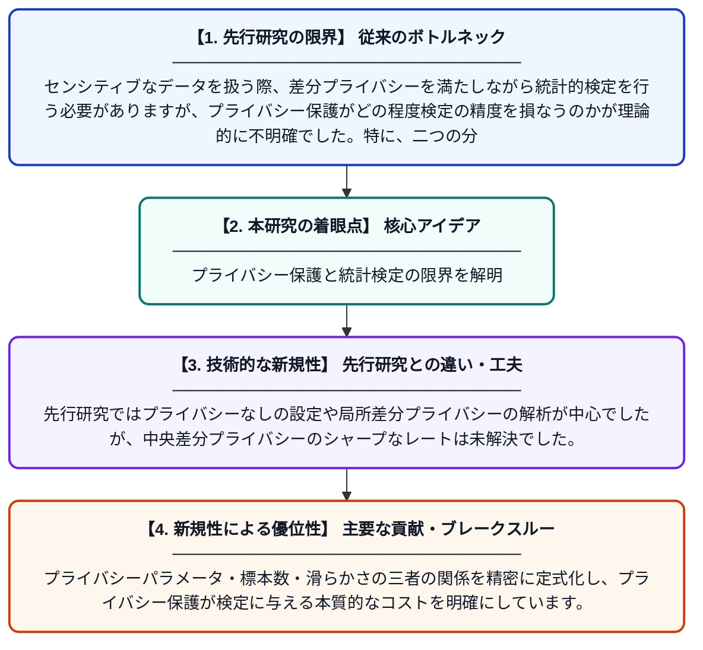

# 中央差分プライバシー下における滑らかな二標本検定のシャープなミニマックスレート

**Original Title**: *Sharp Minimax Rates for Smooth Two-Sample Testing under Central Differential Privacy*

> **💡 一言要約**: プライバシー保護と統計検定の限界を解明

| 項目 | 内容 |
|---|---|
| **著者** | I Kim |
| **掲載誌** | arXiv preprint arXiv:2607.23974 2026 |
| **アラートキーワード** | differential privacy |
| **PDF** | [https://arxiv.org/pdf/2607.23974](https://arxiv.org/pdf/2607.23974) |
| **原文リンク** | [https://arxiv.org/abs/2607.23974](https://arxiv.org/abs/2607.23974) |
| **PDF版要約** | [README.pdf](./README.pdf) |

---

## 📊 新規性の図解（先行研究との違いと本研究のブレークスルー）

## 📝 要約

本論文は、中央差分プライバシー（Central Differential Privacy）の制約下で、二標本検定（Two-Sample Testing）を行う際に必要な分離の大きさを理論的に解明した研究です。Hölder滑らかなクラスの確率分布を対象に、プライバシー保護が検定の難しさ（ミニマックスレート）をどのように変化させるかを正確に特徴付けています。これにより、プライバシーと統計的検出力のトレードオフを鋭く定量化することに成功しています。

## ❓ どんな問題に取り組んだか

センシティブなデータを扱う際、差分プライバシーを満たしながら統計的検定を行う必要がありますが、プライバシー保護がどの程度検定の精度を損なうのかが理論的に不明確でした。特に、二つの分布が同一かどうかを判断する二標本検定において、プライバシー制約下で信頼できる検定に必要な最小の分離量（ミニマックスレート）を明らかにすることが課題でした。

## ✨ 何が新しい？何がすごい？（新規性）

本研究は、中央差分プライバシー下における二標本検定のミニマックス最適な分離レートを、Hölder滑らかなクラスに対してシャープ（上界と下界が一致）に導出した点が主要な貢献です。先行研究ではプライバシーなしの設定や局所差分プライバシーの解析が中心でしたが、中央差分プライバシーのシャープなレートは未解決でした。プライバシーパラメータ・標本数・滑らかさの三者の関係を精密に定式化し、プライバシー保護が検定に与える本質的なコストを明確にしています。

## 🎓 大学1年生向けの解説

二標本検定とは「AグループとBグループのデータは同じ分布から来ているか？」を調べる統計手法です。差分プライバシーとは、個人情報を守るために分析結果に意図的なノイズを加える技術のことです。この研究は、プライバシーを守りながら検定をするとき、「どれくらい差がないと見分けられないか」の限界を数学的に厳密に求めました。つまり、プライバシー保護のコストが統計的な検出力にどう影響するかを、正確な数式で表すことに成功したのです。
