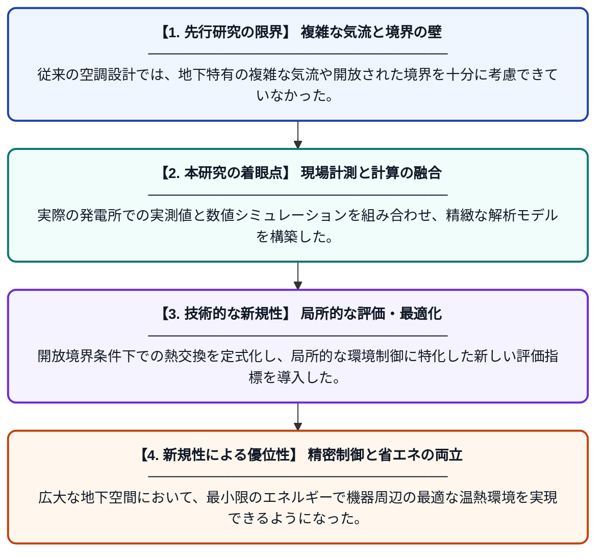

# 深部地下の半密閉空間における現地調査と数値シミュレーションに基づいた局所環境制御の評価と最適化

**Original Title**: *Assessment and optimization of local environmental control in deep underground semi-enclosed spaces based on field investigation and numerical simulation*

> **💡 一言要約**: 地下巨大空間の熱環境を精密に操る最適化手法

| 項目 | 内容 |
|---|---|
| **著者** | C Wen, H Zheng, B Lin, H Sun |
| **掲載誌** | Energy and Buildings 2026 |
| **アラートキーワード** | optimization |
| **原文リンク** | [https://www.sciencedirect.com/science/article/pii/S0378778826015641](https://www.sciencedirect.com/science/article/pii/S0378778826015641) |
| **PDF版要約** | [README.pdf](./README.pdf) |

---

## 📊 新規性の図解（先行研究との違いと本研究のブレークスルー）

## 📝 要約

水力発電所の機器ピットを対象に、深部地下特有の不均一な気流や開放境界が温熱環境に与える影響を調査した研究です。現地調査と数値シミュレーションを組み合わせることで、効率的な局所環境制御の評価手法と最適化案を提案しています。

## ❓ どんな問題に取り組んだか

深部地下の半密閉空間では、空気の流れが複雑で一様ではなく、外部との境界も開いているため、精密な温湿度管理が非常に困難です。従来の空調設計では、このような特殊な条件下での局所的な環境制御を十分に最適化できていませんでした。

## ✨ 何が新しい？何がすごい？（新規性）

本研究は、実際の大規模水力発電所での詳細な現地調査データと高度な数値シミュレーションを統合し、開放境界を持つ空間に特化した評価フレームワークを構築しました。従来の画一的なモデルではなく、現場の複雑な気流パターンを考慮した最適化プロセスを導入した点が画期的です。これにより、エネルギー消費を抑えつつ、機器の安定稼働に必要な局所環境を正確に構築することが可能になりました。

## 🎓 大学1年生向けの解説

地下深くにある発電所の部屋は、湿気が溜まりやすく温度調節も難しい特殊な場所です。この研究では、実際の現場で空気の流れを詳しく調べ、コンピュータを使って「どうすれば効率よく冷やしたり乾かしたりできるか」を計算しました。壁がない広い空間の中で、特定の場所だけをピンポイントで快適に保つための新しい計算方法を編み出したのがこの研究のすごいところです。
