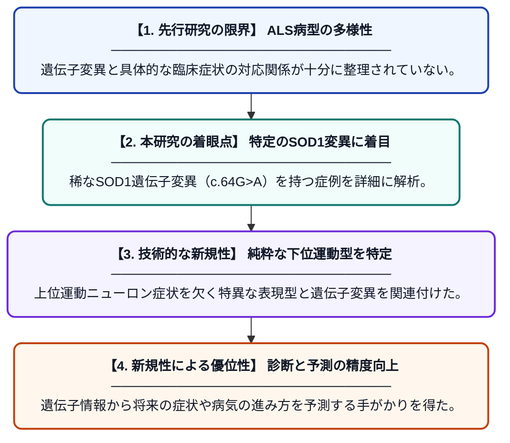

# SOD1遺伝子c.64G>A変異に関連する、純粋な下位運動ニューロン型筋萎縮性側索硬化症（ALS）：症例報告

**Original Title**: *Pure lower motor neuron phenotype in amyotrophic lateral sclerosis associated with the SOD1 c. 64G> A variant: case report*

> **💡 一言要約**: SOD1変異による特異なALS病型を解明

| 項目 | 内容 |
|---|---|
| **著者** | MEB Furian, FB Bolli, FP Martins, KO Harada… |
| **掲載誌** | Arq. Neuro-Psiquiatr. 2026 |
| **アラートキーワード** | ALS |
| **原文リンク** | [https://www.arquivosdeneuropsiquiatria.org/article/pure-lower-motor-neuron-phenotype-in-amyotrophic-lateral-sclerosis-associated-with-the-sod1-c-64ga-variant-case-report/](https://www.arquivosdeneuropsiquiatria.org/article/pure-lower-motor-neuron-phenotype-in-amyotrophic-lateral-sclerosis-associated-with-the-sod1-c-64ga-variant-case-report/) |
| **PDF版要約** | [README.pdf](./README.pdf) |

---

## 📊 新規性の図解（先行研究との違いと本研究のブレークスルー）

## 📝 要約

SOD1遺伝子の特定の変異（c.64G>A）を持つALS患者において、通常とは異なる「純粋な下位運動ニューロン型」の症状が示された症例を報告しています。この研究は、特定の遺伝子変異がALSの多様な臨床像（フェノタイプ）にどのように影響するかを明らかにしました。

## ❓ どんな問題に取り組んだか

ALSは通常、上位と下位の両方の運動ニューロンが侵される疾患ですが、患者ごとに症状の現れ方は大きく異なります。特にSOD1遺伝子変異に関連する症例において、特定の変異がどのような臨床的特徴をもたらすのかについては、まだ十分な知見が得られていませんでした。

## ✨ 何が新しい？何がすごい？（新規性）

本研究の新規性は、SOD1遺伝子の「c.64G>A」という特定の変異が、上位運動ニューロンの兆候を伴わない「純粋な下位運動ニューロン型」のALSを引き起こすことを特定した点にあります。これは、遺伝子型と臨床症状の相関関係を具体的に示す貴重なデータです。従来のSOD1関連ALSの典型的なイメージを広げ、診断の幅を広げる重要な貢献をしています。

## 🎓 大学1年生向けの解説

筋肉を動かす神経が壊れていくALSという病気には、いくつかの原因遺伝子があります。通常、ALSは「脳」と「脊髄」の両方の神経がダメージを受けますが、この研究で見つかった患者さんは「脊髄（下位）」の神経だけがやられるという珍しいタイプでした。その原因を調べたところ、SOD1という遺伝子の特定の場所に変化があることがわかりました。この発見は、遺伝子の小さな違いが病気の現れ方をどう変えるかを知るための大切な一歩です。
