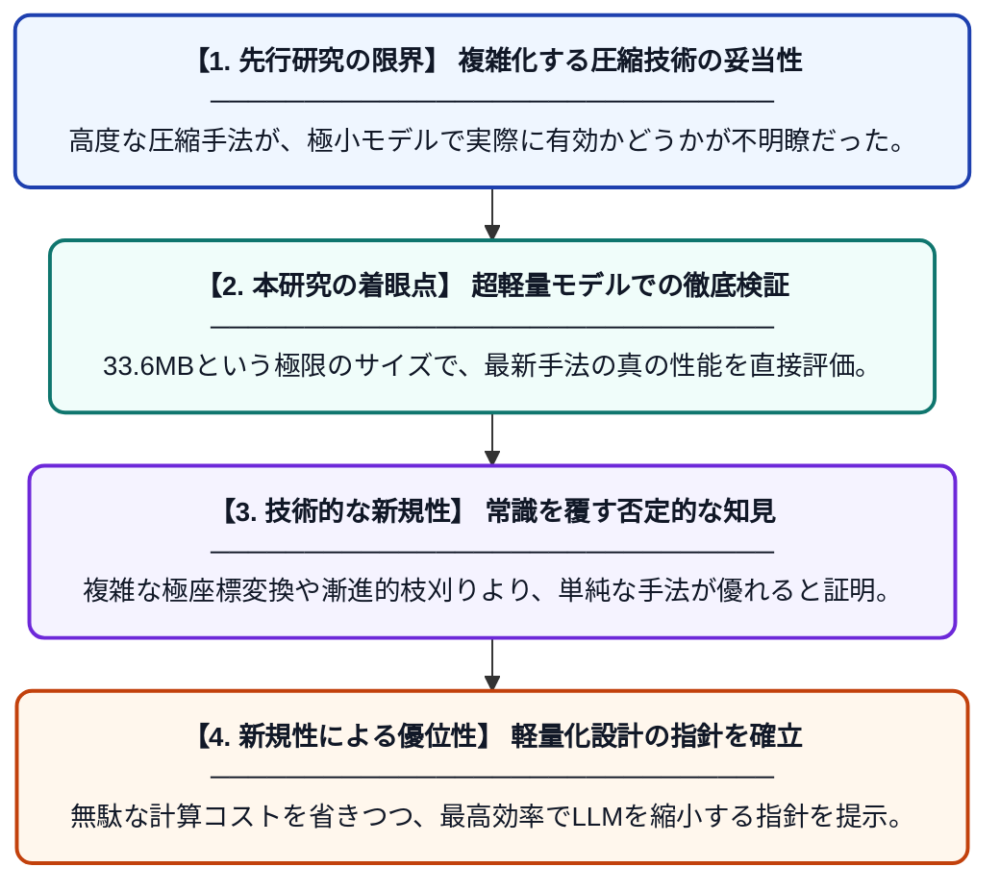

# EdgeLLM-Nano: 33.6 MBのオンデバイス言語モデルにおける極座標誘導型キーキャッシュ圧縮と整合性固定プルーニングの検証

**Original Title**: *EdgeLLM-Nano: Auditing Polar-Guided Key-Cache Compression and Consistency-Anchored Pruning on a 33.6 MB On-Device Language Model*

> **💡 一言要約**: 複雑な最新圧縮術の限界を暴き、基本の重要性を再考する

| 項目 | 内容 |
|---|---|
| **著者** | SM Mahbub Murshed, H Bright, R Karim… |
| **掲載誌** | arXiv e-prints 2026 |
| **アラートキーワード** | one shot |
| **原文リンク** | [https://ui.adsabs.harvard.edu/abs/2026arXiv261014475M/abstract](https://ui.adsabs.harvard.edu/abs/2026arXiv261014475M/abstract) |
| **PDF版要約** | [README.pdf](./README.pdf) |

---

## 📊 新規性の図解（先行研究との違いと本研究のブレークスルー）

## 📝 要約

33.6 MBという極小サイズのオンデバイスLLMを用いて、最新のモデル圧縮手法を徹底的に監査した研究です。検証の結果、期待されていた「極座標誘導型量子化」や「整合性固定プルーニング」が、実は単純な既存手法よりも劣る、あるいは同等の性能しか発揮しないという実証的な否定結果を示しました。

## ❓ どんな問題に取り組んだか

スマートフォンなどのリソースが制限された環境でLLMを動作させるため、モデルを極限まで軽量化する技術が求められています。しかし、近年提案されている複雑な圧縮アルゴリズムが、実際に超小型モデル（EdgeLLM-Nano）において十分な効果を発揮するのか、厳密な検証が不足していました。

## ✨ 何が新しい？何がすごい？（新規性）

33.6 MBという極めて小さな実用モデルを対象に、高度とされる圧縮技術の実効性を「監査（Auditing）」した点が独創的です。先行研究が推奨する複雑な手法に対し、「単純な丸め処理（RTN）の方が精度低下が10分の1で済む」といった衝撃的な事実を明らかにしました。この研究は、オンデバイスAI設計において『複雑さが必ずしも性能向上に繋がらない』という重要な知見を提示しています。

## 🎓 大学1年生向けの解説

スマホのような小さな機械で動く「超ミニAI」を、どうすれば効率よく作れるか調べた研究です。AIを小さくするにはデータの削り方に工夫が必要ですが、この論文では「最新の難しい方法」と「昔ながらの簡単な方法」を戦わせました。その結果、実は簡単な方法の方がAIの賢さを保てることが分かりました。無理に難しくするより、基本をしっかり使う方が良いAIが作れるという、目からウロコの発見です。
