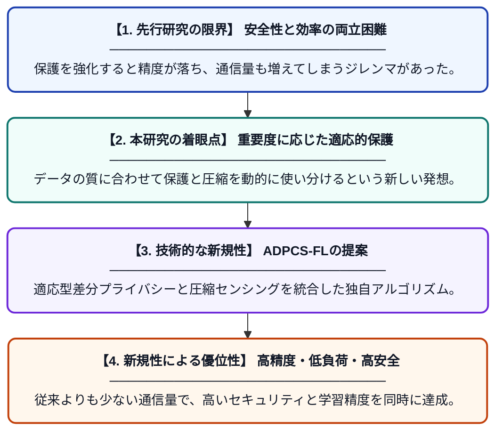

# ADPCS-FL：エッジコンピューティングに向けた適応型差分プライバシーと圧縮センシングに基づく効率的な連合学習

**Original Title**: *ADPCS-FL: An Efficient Federated Learning Based on Adaptive Differential Privacy and Compressed Sensing for Edge computing*

> **💡 一言要約**: プライバシー保護と通信の軽さを両立する連合学習

| 項目 | 内容 |
|---|---|
| **著者** | H Kang, C Du |
| **掲載誌** | IEEE Internet of Things Journal 2026 |
| **アラートキーワード** | Federated Learning |
| **原文リンク** | [https://ieeexplore.ieee.org/abstract/document/11753646/](https://ieeexplore.ieee.org/abstract/document/11753646/) |
| **PDF版要約** | [README.pdf](./README.pdf) |

---

## 📊 新規性の図解（先行研究との違いと本研究のブレークスルー）

## 📝 要約

エッジ連合学習におけるプライバシー漏洩のリスクと膨大な通信コストの課題を解決するため、新しいフレームワーク「ADPCS-FL」を提案しています。適応型差分プライバシーと圧縮センシングを統合することで、データの安全性を守りつつ通信量を劇的に削減することに成功しました。

## ❓ どんな問題に取り組んだか

連合学習はデータを共有せず学習できる手法ですが、勾配情報の交換から元のデータが推測されるリスクがあります。また、端末とサーバー間の通信量が非常に大きく、特にリソースの限られたエッジデバイスにおいて大きな負荷となっていました。

## ✨ 何が新しい？何がすごい？（新規性）

本研究の核心は、データの重要度に応じてノイズ量を調整する「適応型差分プライバシー」と、データ転送量を大幅に減らす「圧縮センシング」を組み合わせた点にあります。従来手法はプライバシーを保護しようとすると精度が下がる傾向にありましたが、本提案では精度を維持しつつ双方向の通信負荷を抑える仕組みを構築しました。これにより、セキュリティと効率性のトレードオフを高度に解決しています。

## 🎓 大学1年生向けの解説

「連合学習」は、みんなのデータを一箇所に集めずにAIを賢くする便利な仕組みですが、通信の途中で中身が盗み見られたり、データの送受信に時間がかかりすぎたりする問題がありました。この研究では、データを「圧縮」して小さく送りつつ、さらに「特殊なノイズ」を混ぜることで、誰かに見られても中身が分からないようにしました。これにより、スマホのような小さな機械でも、安全かつ素早くAIを育てることができるようになります。
