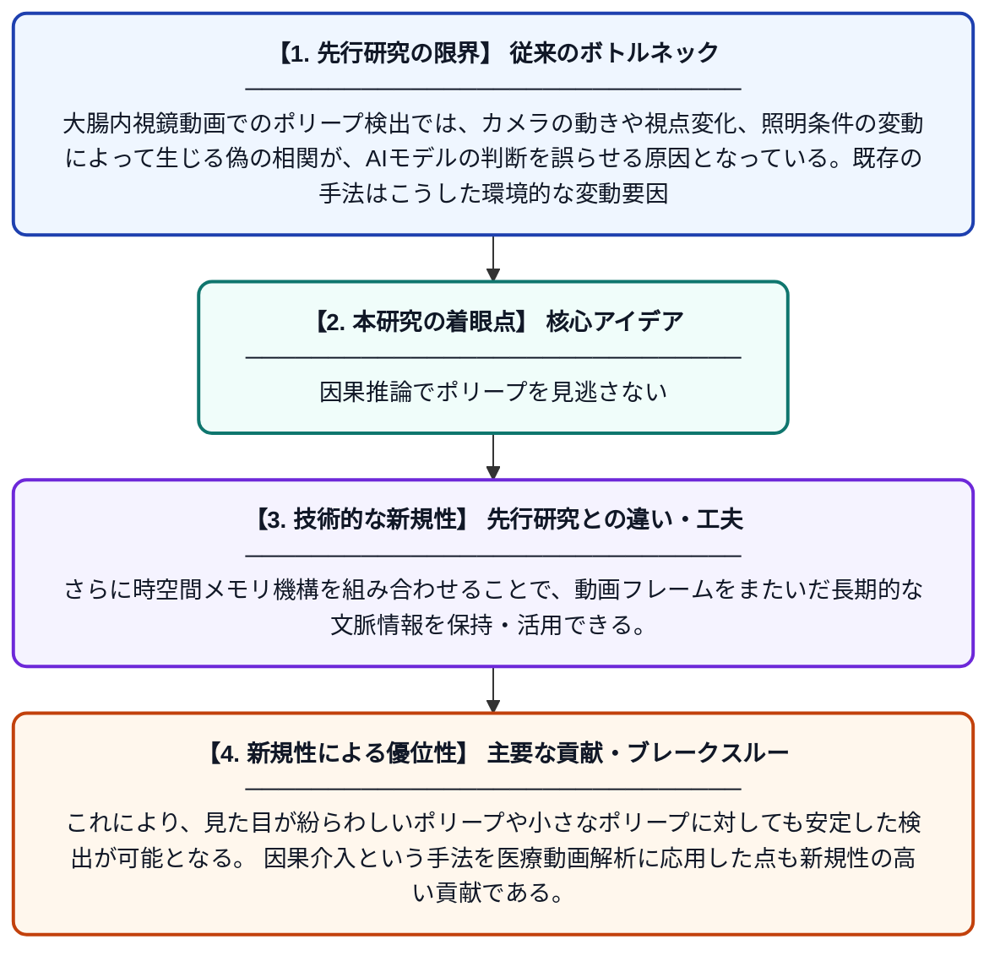

# 内視鏡動画におけるポリープ検出のための時空間メモリを用いた因果性にインスパイアされた表現学習

**Original Title**: *Causality-inspired representation learning with spatiotemporal memory for polyp detection in endoscopic videos*

> **💡 一言要約**: 因果推論でポリープを見逃さない

| 項目 | 内容 |
|---|---|
| **著者** | Z Hu, C Sun, Q Zheng, X He, C Xue, G Zhou, Y Chen |
| **掲載誌** | Medical Image Analysis 2026 |
| **アラートキーワード** | representation learning |
| **原文リンク** | [https://www.sciencedirect.com/science/article/pii/S1361841526003002](https://www.sciencedirect.com/science/article/pii/S1361841526003002) |
| **PDF版要約** | [README.pdf](./README.pdf) |

---

## 📊 新規性の図解（先行研究との違いと本研究のブレークスルー）

## 📝 要約

本論文は、大腸内視鏡動画におけるポリープ検出の精度向上を目的とした、因果性に基づく表現学習フレームワーク「CIRL-Polyp」を提案する。カメラ視点の変化や照明の揺らぎといった偽の相関（スプリアスな特徴）に惑わされない頑健な特徴抽出を実現するため、視点変化を考慮した因果介入モジュール（VACIM）と時空間メモリ機構を組み合わせている。これにより、動画中の時間的・空間的な文脈情報を活用しながら、真にポリープに関連する特徴を学習できる。

## ❓ どんな問題に取り組んだか

大腸内視鏡動画でのポリープ検出では、カメラの動きや視点変化、照明条件の変動によって生じる偽の相関が、AIモデルの判断を誤らせる原因となっている。既存の手法はこうした環境的な変動要因と、実際のポリープの特徴を適切に切り分けられていないため、検出精度が不安定になりやすい。

## ✨ 何が新しい？何がすごい？（新規性）

先行研究が単純な時系列特徴の集約に留まっていたのに対し、本研究は因果推論の考え方を導入し、視点変化に起因するスプリアスな特徴を明示的に除去するVACIMを新たに設計した点が独創的である。さらに時空間メモリ機構を組み合わせることで、動画フレームをまたいだ長期的な文脈情報を保持・活用できる。これにより、見た目が紛らわしいポリープや小さなポリープに対しても安定した検出が可能となる。因果介入という手法を医療動画解析に応用した点も新規性の高い貢献である。

## 🎓 大学1年生向けの解説

大腸の内視鏡検査では、カメラが動いたり光の当たり方が変わったりすることで、AIがポリープ（大腸のできもの）を見つけにくくなることがあります。この研究では、「因果推論」というAIの考え方を使って、カメラの動きなど関係のない要因に惑わされずにポリープだけの特徴を学習させる仕組みを作りました。さらに、動画の過去のフレームの情報を「メモリ」として蓄えておくことで、時間的なつながりも考慮できるようにしました。これによって、医師が見逃しやすい小さなポリープも精度よく検出できることを目指しています。
