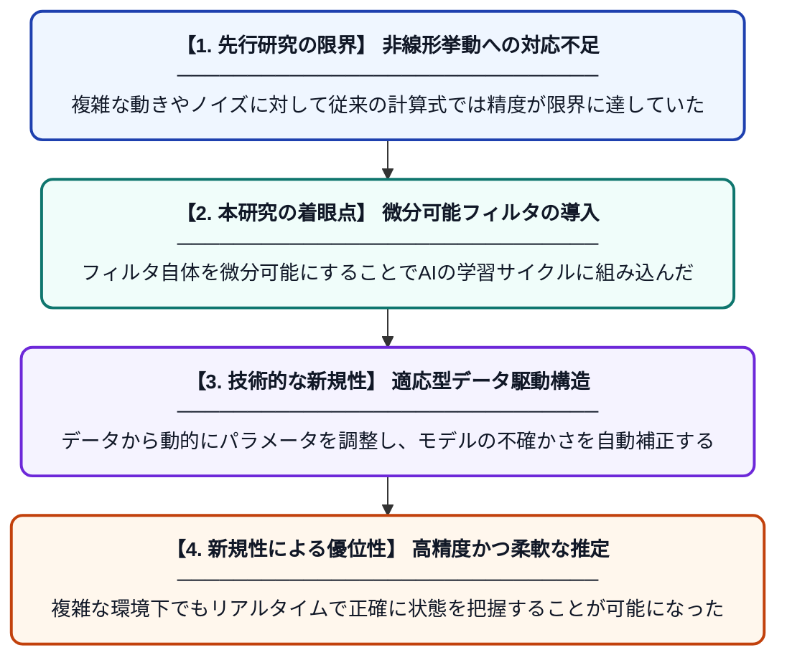

# データ駆動型微分可能適応アンサンブルカルマンフィルタ

**Original Title**: *Data-Driven Differentiable Adaptive*

> **💡 一言要約**: AIと融合し進化を遂げた次世代の状態推定技術

| 項目 | 内容 |
|---|---|
| **著者** | M Yang, K Zhang, X Ma, Y Ji, L Ren |
| **掲載誌** | Advances in Dynamics of Vehicles on Roads … 2026 |
| **アラートキーワード** | kalman filter |
| **原文リンク** | [https://books.google.com/books?hl=ja&lr=lang_ja|lang_en&id=cdQoEgAAQBAJ&oi=fnd&pg=PA118&dq="kalman+filter"&ots=_S1h4TpTSV&sig=n2e83d4l1f6IpTBN6pfue-Xh3wI](https://books.google.com/books?hl=ja&lr=lang_ja|lang_en&id=cdQoEgAAQBAJ&oi=fnd&pg=PA118&dq="kalman+filter"&ots=_S1h4TpTSV&sig=n2e83d4l1f6IpTBN6pfue-Xh3wI) |
| **PDF版要約** | [README.pdf](./README.pdf) |

---

## 📊 新規性の図解（先行研究との違いと本研究のブレークスルー）

## 📝 要約

複雑な非線形ダイナミクスや多源的なデータに対応するため、アンサンブルカルマンフィルタを微分可能かつ適応的な形式へと拡張しました。データ駆動型アプローチを統合することで、車両動力学などの動的システムにおける状態推定の精度を大幅に向上させています。

## ❓ どんな問題に取り組んだか

従来のカルマンフィルタや随伴変数法では、高度に非線形なシステムや不規則なノイズが混在する環境下で、推定精度を維持することが困難でした。また、複雑な物理モデルをリアルタイムで最適化するには計算コストやモデル化の限界という課題がありました。

## ✨ 何が新しい？何がすごい？（新規性）

本研究の最大の特徴は、アンサンブルカルマンフィルタ（EnKF）に微分可能な構造を導入し、データ駆動型の適応メカニズムを統合した点です。これにより、ディープラーニングのような勾配ベースの最適化手法を用いて、フィルタのパラメータをエンドツーエンドで学習させることが可能になりました。先行研究とは異なり、システムの動的な変化に応じてノイズ特性を自己調整できる柔軟性を備えています。

## 🎓 大学1年生向けの解説

ロボットや車の動きを予測する際、センサーの誤差や急な揺れのせいで計算が外れてしまうことがあります。この研究では、AIの技術を使って「計算のルール自体をデータの変化に合わせて賢く書き換える」仕組みを作りました。これまでは難しい計算が必要だった複雑な動きも、過去のデータから学ぶことで正確に追跡できるようになります。数学的な予測手法と最新のAIを組み合わせた、非常に賢い「予測のメガネ」のような技術です。
