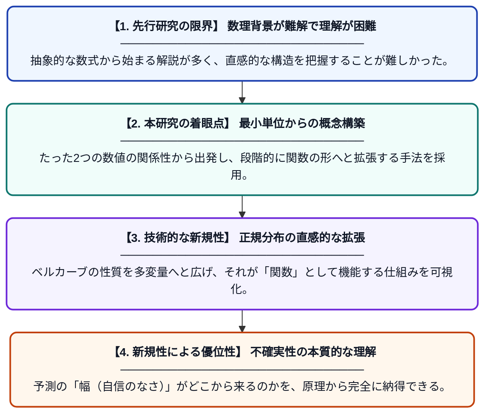

# ガウス過程の原理：基本からの構築

**Original Title**: *Gaussian processes from first principles*

> **💡 一言要約**: 正規分布から学ぶ、ガウス過程の仕組みと真髄

| 項目 | 内容 |
|---|---|
| **著者** | M Güven |
| **アラートキーワード** | gaussian process |
| **原文リンク** | [https://likemaestro.github.io/articles/gaussian-processes](https://likemaestro.github.io/articles/gaussian-processes) |
| **PDF版要約** | [README.pdf](./README.pdf) |

---

## 📊 新規性の図解（先行研究との違いと本研究のブレークスルー）

## 📝 要約

ガウス過程は、観測されていない地点の値を予測し、その不確実性を範囲として提示する手法です。本論文では、正規分布という身近な概念から出発し、ガウス過程を最小単位から段階的に構築して解説しています。

## ❓ どんな問題に取り組んだか

未知の関数を推定する際、単なる予測値だけでなく「予測の不確実性」を正しく評価することは困難です。また、ガウス過程の数学的背景は抽象度が高く、初学者がその本質を直感的に理解するのが難しいという課題がありました。

## ✨ 何が新しい？何がすごい？（新規性）

本論文は、高度な数式から入るのではなく「2つの数値」という最小単位からガウス過程をボトムアップで再構築する教育的アプローチをとっています。正規分布（ベルカーブ）の基本的な性質が、どのようにして無限次元の関数表現へと拡張されるのかを視覚的かつ論理的に結びつけています。これにより、ブラックボックスになりがちなカーネル手法や共分散行列の意味を、原理原則から具体化している点が優れています。

## 🎓 大学1年生向けの解説

「ある場所の気温がわかれば、その隣の場所の気温もだいたい予想できる」という直感を、数学的に形にしたのがガウス過程です。この論文では、山のような形のグラフ（正規分布）を組み合わせて、複雑な曲線を予測する方法を優しく説明しています。ただ予測するだけでなく「ここから先は自信がない」という予報の信頼度も教えてくれる魔法のような道具を、基礎から学べます。
