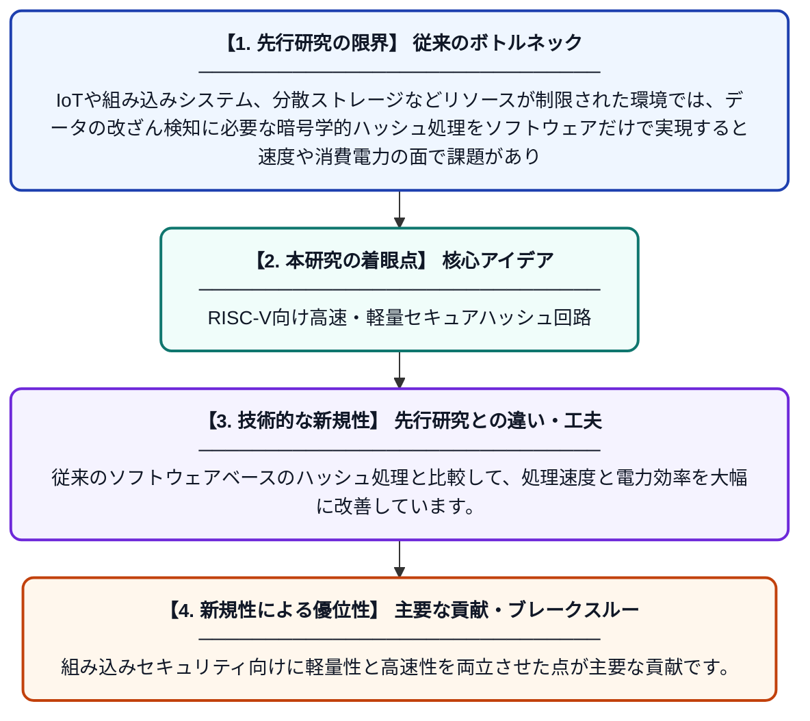

# RISC-Vシステムにおけるセキュアなデータ整合性のためのハードウェア高速化軽量ローリングハッシュアーキテクチャ

**Original Title**: *Hardware Accelerated Lightweight Rolling Hash Architecture for Secure Data Integrity in RISC-V Systems*

> **💡 一言要約**: RISC-V向け高速・軽量セキュアハッシュ回路

| 項目 | 内容 |
|---|---|
| **著者** | KK Sreegayathri, B Koushik, LS Raahul |
| **掲載誌** | 2026 IEEE 6th International … 2026 |
| **アラートキーワード** | Secure Computing |
| **原文リンク** | [https://ieeexplore.ieee.org/abstract/document/11610186/](https://ieeexplore.ieee.org/abstract/document/11610186/) |
| **PDF版要約** | [README.pdf](./README.pdf) |

---

## 📊 新規性の図解（先行研究との違いと本研究のブレークスルー）

## 📝 要約

本論文は、RISC-Vプロセッサシステム上でデータの改ざんを検出するための、ハードウェアで高速化した軽量なローリングハッシュアーキテクチャを提案しています。512ビット入力を処理できる設計により、組み込みシステムや分散ストレージ環境における高速かつ安全なデータ整合性検証を実現します。リソースが限られた組み込みコンピューティング環境でも効率的に動作することを目指しています。

## ❓ どんな問題に取り組んだか

IoTや組み込みシステム、分散ストレージなどリソースが制限された環境では、データの改ざん検知に必要な暗号学的ハッシュ処理をソフトウェアだけで実現すると速度や消費電力の面で課題があります。特にRISC-Vのような軽量プロセッサ向けに、低リソースかつ高速なセキュリティ機構が求められています。

## ✨ 何が新しい？何がすごい？（新規性）

本研究は、RISC-Vアーキテクチャに特化したハードウェアアクセラレータとしてローリングハッシュを実装した点が新しく、512ビットのデータを効率的に処理できる専用回路設計を提案しています。従来のソフトウェアベースのハッシュ処理と比較して、処理速度と電力効率を大幅に改善しています。組み込みセキュリティ向けに軽量性と高速性を両立させた点が主要な貢献です。

## 🎓 大学1年生向けの解説

コンピュータにデータを保存するとき、そのデータが誰かに勝手に書き換えられていないかを確認する仕組みが必要です。その確認に使われるのが『ハッシュ』という計算で、データから固有の指紋のような数値を生成します。この研究では、スマート家電などに使われる小型コンピュータ（RISC-V）向けに、そのハッシュ計算を専用の回路で超高速に行えるようにしました。ソフトウェアだけで計算するより速く、消費電力も少なくて済むため、小さなデバイスでも安全にデータを守ることができます。
