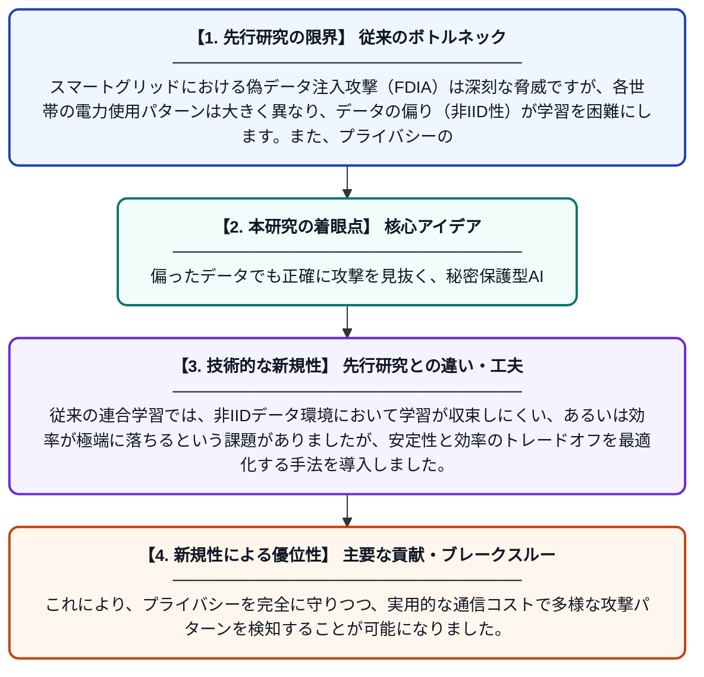

# 非IIDデータ環境下の高度計測インフラにおける偽データ注入攻撃検知のための堅牢な連合学習

**Original Title**: *Robust federated learning for detecting false data injection attacks in advanced metering infrastructure under non-IID data*

> **💡 一言要約**: 偏ったデータでも正確に攻撃を見抜く、秘密保護型AI

| 項目 | 内容 |
|---|---|
| **著者** | Y Wei, G Gong, L Cao |
| **掲載誌** | Scientific Reports 2026 |
| **アラートキーワード** | Federated Learning |
| **PDF** | [https://www.nature.com/articles/s41598-026-72303-6_reference.pdf](https://www.nature.com/articles/s41598-026-72303-6_reference.pdf) |
| **原文リンク** | [https://www.nature.com/articles/s41598-026-72303-6_reference.pdf](https://www.nature.com/articles/s41598-026-72303-6_reference.pdf) |
| **PDF版要約** | [README.pdf](./README.pdf) |

---

## 📊 新規性の図解（先行研究との違いと本研究のブレークスルー）

## 📝 要約

スマートメーター等の高度計測インフラにおいて、偽データを注入するサイバー攻撃を検知するための新しい連合学習手法を提案しています。データの偏り（非IID）が激しい環境下でも、プライバシーを保護しながら高い検知精度と学習の安定性を両立させています。

## ❓ どんな問題に取り組んだか

スマートグリッドにおける偽データ注入攻撃（FDIA）は深刻な脅威ですが、各世帯の電力使用パターンは大きく異なり、データの偏り（非IID性）が学習を困難にします。また、プライバシーの観点から個人の使用データを中央サーバーに集約できないため、分散環境での高精度な検知モデルの構築が求められていました。

## ✨ 何が新しい？何がすごい？（新規性）

本研究の核心は、データの偏りが激しい状況でもモデルが不安定にならない「堅牢な連合学習アルゴリズム」を開発した点にあります。従来の連合学習では、非IIDデータ環境において学習が収束しにくい、あるいは効率が極端に落ちるという課題がありましたが、安定性と効率のトレードオフを最適化する手法を導入しました。これにより、プライバシーを完全に守りつつ、実用的な通信コストで多様な攻撃パターンを検知することが可能になりました。

## 🎓 大学1年生向けの解説

家にあるスマートメーターのデータを嘘の数字に書き換えて、電気代をごまかしたり停電を引き起こしたりする攻撃があります。これを防ぐにはAIが必要ですが、電力の使い方は家庭ごとにバラバラなため、AIを教育するのがとても大変でした。この研究では、みんなのデータを一箇所に集めてプライバシーを侵害することなく、それぞれの場所でAIを少しずつ賢くし、それを上手にまとめる魔法のような方法を開発しました。これにより、どんなに生活スタイルが違う家庭でも、嘘のデータを見破れるようになります。
