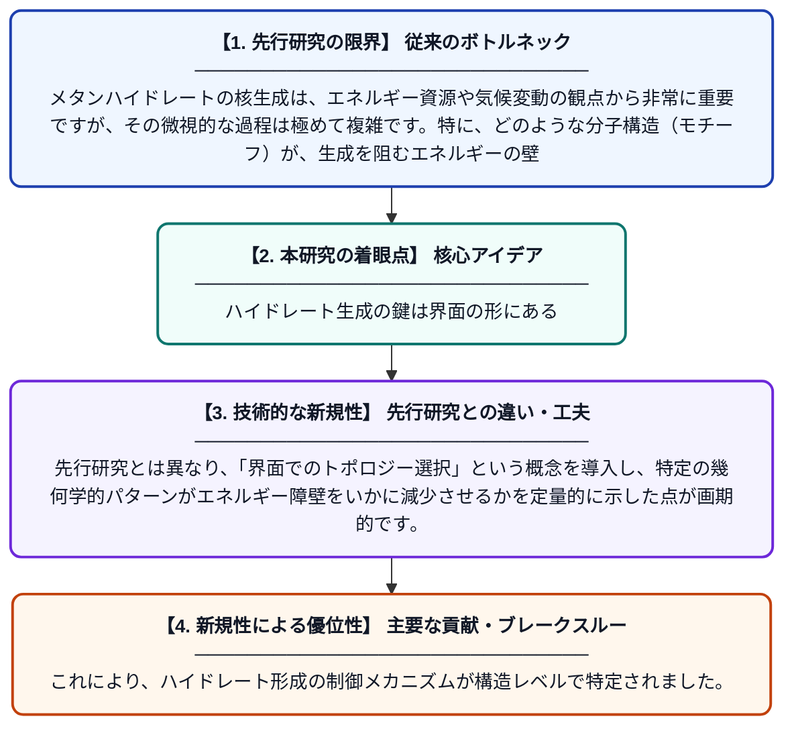

# 界面トポロジーの選択がメタンハイドレート核生成の構造モチーフと自由エネルギー障壁を繋ぐ

**Original Title**: *Interfacial topological selection links structural motifs to the free-energy barrier in methane hydrate nucleation*

> **💡 一言要約**: ハイドレート生成の鍵は界面の形にある

| 項目 | 内容 |
|---|---|
| **著者** | Y Hao, Y Qu, G Luo, Z Zhang, J Wu |
| **掲載誌** | Journal of Colloid and Interface Science 2026 |
| **アラートキーワード** | independent component ... |
| **原文リンク** | [https://www.sciencedirect.com/science/article/pii/S0021979726020229](https://www.sciencedirect.com/science/article/pii/S0021979726020229) |
| **PDF版要約** | [README.pdf](./README.pdf) |

---

## 📊 新規性の図解（先行研究との違いと本研究のブレークスルー）

## 📝 要約

メタンハイドレートの核生成プロセスを分子動力学シミュレーションとtICA解析によって詳細に調査しました。界面におけるトポロジー的な選択が、ハイドレートの結晶成長に不可欠な特定の構造モチーフをどのように決定し、自由エネルギー障壁に影響を与えるかを明らかにしています。

## ❓ どんな問題に取り組んだか

メタンハイドレートの核生成は、エネルギー資源や気候変動の観点から非常に重要ですが、その微視的な過程は極めて複雑です。特に、どのような分子構造（モチーフ）が、生成を阻むエネルギーの壁（障壁）を乗り越えるのに寄与しているのかが明確ではありませんでした。

## ✨ 何が新しい？何がすごい？（新規性）

本研究は、複数の分子動力学シミュレーションに時間差独立成分分析（tICA）を組み合わせることで、核生成の自由エネルギー地形を精密に描写しました。先行研究とは異なり、「界面でのトポロジー選択」という概念を導入し、特定の幾何学的パターンがエネルギー障壁をいかに減少させるかを定量的に示した点が画期的です。これにより、ハイドレート形成の制御メカニズムが構造レベルで特定されました。

## 🎓 大学1年生向けの解説

「燃える氷」と呼ばれるメタンハイドレートが、水とメタンからどのようにして生まれるのかをコンピューターシミュレーションで解明した研究です。ハイドレートができる瞬間には、分子が特定の「幾何学的な形」を優先的に作ることで、結晶への変化をスムーズに進めていることが分かりました。この仕組みを理解することは、将来のエネルギー開発や、パイプラインの詰まりを防ぐ技術の開発に役立ちます。
