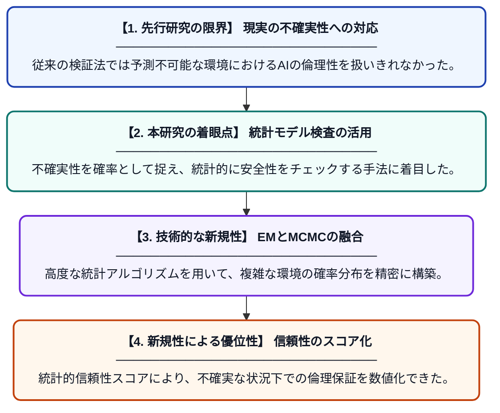

# 不確実性下における倫理的自律システムの統計モデル検査

**Original Title**: *Statistical Model Checking of Ethical Autonomous System Under Uncertainty*

> **💡 一言要約**: 不確実な環境でAIの倫理性を数学的に検証する

| 項目 | 内容 |
|---|---|
| **著者** | J Godawa, K Ghosh |
| **掲載誌** | Proceedings of the AAAI Symposium Series 2026 |
| **アラートキーワード** | MCMC |
| **PDF** | [https://ojs.aaai.org/index.php/AAAI-SS/article/download/43507/51066](https://ojs.aaai.org/index.php/AAAI-SS/article/download/43507/51066) |
| **原文リンク** | [https://ojs.aaai.org/index.php/AAAI-SS/article/download/43507/51066](https://ojs.aaai.org/index.php/AAAI-SS/article/download/43507/51066) |
| **PDF版要約** | [README.pdf](./README.pdf) |

---

## 📊 新規性の図解（先行研究との違いと本研究のブレークスルー）

## 📝 要約

現実世界の不確実な状況下で動作するAIなどの自律システムが、倫理的基準を遵守しているかを統計的に検証する手法を提案しています。EMアルゴリズムやMCMC法を用いて構築した確率分布に基づき、システムの振る舞いが倫理的に許容されるかを数学的に評価します。

## ❓ どんな問題に取り組んだか

現実世界の複雑で予測不可能な状況において、自律システムが倫理的な判断を下せるかを保証することは極めて困難です。従来の検証手法では、不確実性が高い環境における動的なリスクや倫理違反の可能性を、定量的に評価する枠組みが不足していました。

## ✨ 何が新しい？何がすごい？（新規性）

EMアルゴリズムによる最尤推定とMCMC法を組み合わせ、不確実性を考慮した高度な確率分布を構築し、これを統計モデル検査（SMC）に統合した点が独創的です。従来の決定論的な検証とは異なり、統計的信頼性（SC）スコアを導入することで、検証結果の確からしさを数値で示した点が大きな貢献です。これにより、データが不完全な状況でも倫理的リスクを精度高く見積もることが可能になりました。

## 🎓 大学1年生向けの解説

AIが「正しい判断」をしているかを確かめるのは非常に難しい問題です。この研究は、AIが予測できない事態に遭遇したとき、どれくらいの確率でルールを守れるかを計算する新しい方法を開発しました。数学的なシミュレーションを繰り返すことで、AIの安全性を数字で証明しようとしています。これにより、将来の自動運転車などがより信頼できるものになると期待されます。
