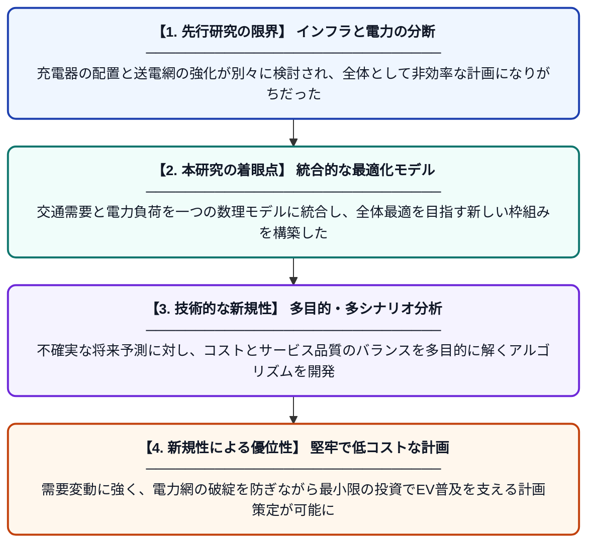

# 複数のシナリオに基づく高速道路の電気自動車充電インフラ計画と電力網強化：多目的最適化アプローチ

**Original Title**: *Integrated Electric Vehicle Highway Charging Infrastructure Planning and Grid Reinforcement Under Alternative Scenarios: A Multi-Objective Optimization Approach …*

> **💡 一言要約**: EV充電網と電力インフラを同時に最適化する新手法

| 項目 | 内容 |
|---|---|
| **著者** | B Alptekin, ŞI Satoğlu, M Marinelli |
| **掲載誌** | World Electric Vehicle Journal 2026 |
| **アラートキーワード** | reinforcement |
| **原文リンク** | [https://www.mdpi.com/2032-6653/17/11/556](https://www.mdpi.com/2032-6653/17/11/556) |
| **PDF版要約** | [README.pdf](./README.pdf) |

---

## 📊 新規性の図解（先行研究との違いと本研究のブレークスルー）

## 📝 要約

高速道路における電気自動車（EV）の普及を支えるため、充電ステーションの配置と電力網の増強を同時に計画する多目的最適化手法を提案しています。長距離走行時の充電不安を解消しつつ、インフラ投資コストと電力供給の安定性を両立させる最適な整備指針を導き出しました。

## ❓ どんな問題に取り組んだか

EVの長距離移動を支えるには高速道路への充電器設置が不可欠ですが、設置場所の選定は複雑です。さらに、急速充電器の導入は既存の電力網に大きな負荷をかけるため、充電インフラの整備と電力網の強化を個別に考えるだけでは、コストや安定性の面で不十分という課題がありました。

## ✨ 何が新しい？何がすごい？（新規性）

本研究の最大の特長は、充電ステーションの配置計画と電力網の補強計画を一つの最適化モデルに統合した点にあります。複数の将来シナリオ（EV普及率の変化など）を考慮に入れ、コスト最小化とユーザーの利便性最大化という相反する目標を同時に追求する多目的最適化を実現しました。交通流の動態と電力システムの制約を高度に連携させた分析は、先行研究にはない包括的なアプローチです。

## 🎓 大学1年生向けの解説

電気自動車で遠くまでドライブするとき、途中で充電が切れないか心配になりますよね。この研究は、高速道路のどこに充電器を置けばみんなが便利に使えるか、そしてその充電器に電気を送る電線がパンクしないためにはどう補強すればいいかを計算で求めるものです。将来、電気自動車がもっと増えても困らないように、今のうちに一番効率的で安上がりな工事計画を立てるための「賢い設計図」を作るような研究です。
