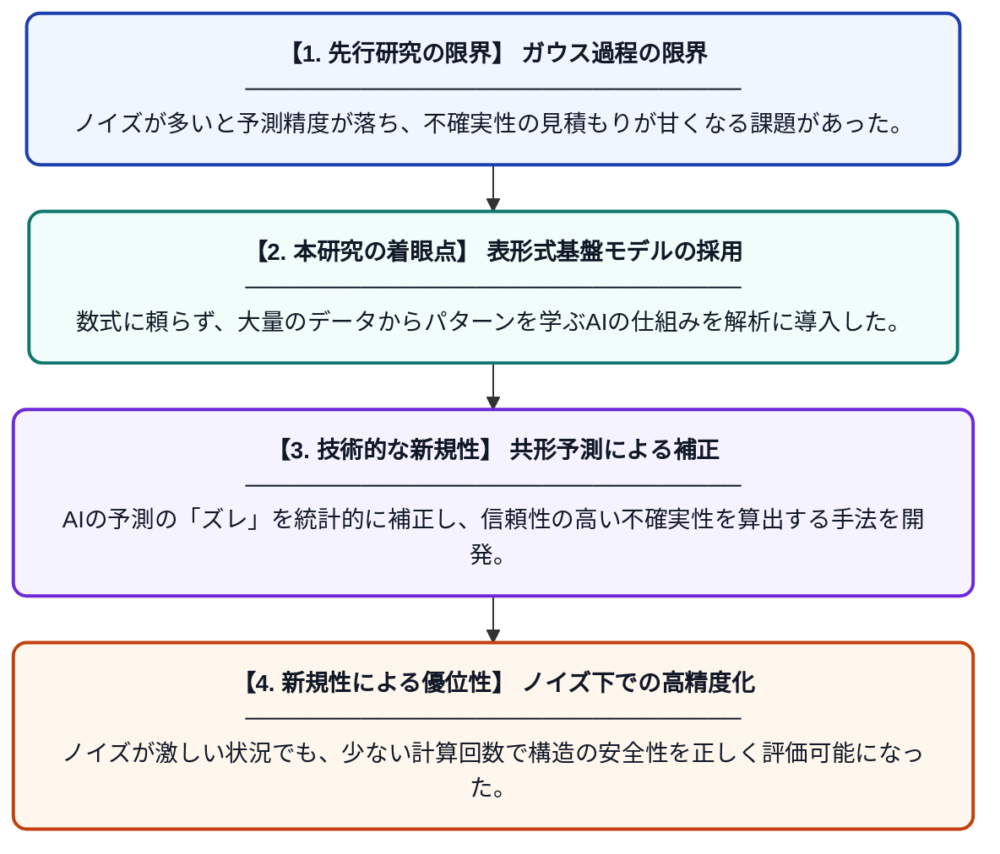

# 共形キャリブレーションを備えたインコンテキスト表形式基盤モデルによるノイズに強い能動学習型構造信頼性解析

**Original Title**: *Noise-robust active-learning structural reliability analysis using an in-context tabular foundation model with conformal calibration*

> **💡 一言要約**: 基盤モデルと共形予測で、ノイズに強い構造解析を実現

| 項目 | 内容 |
|---|---|
| **著者** | AT Vu, KA Do, TT Nguyen, VH Dang |
| **掲載誌** | Structures 2026 |
| **アラートキーワード** | gaussian process |
| **原文リンク** | [https://www.sciencedirect.com/science/article/pii/S2352012426022733](https://www.sciencedirect.com/science/article/pii/S2352012426022733) |
| **PDF版要約** | [README.pdf](./README.pdf) |

---

## 📊 新規性の図解（先行研究との違いと本研究のブレークスルー）

## 📝 要約

ノイズを含む評価関数に対処するため、ガウス過程の代わりに表形式データ用の基盤モデルと「共形予測（Conformal Calibration）」を組み合わせた新しい能動学習手法を提案しています。複雑な不確実性が存在する状況下でも、計算コストを抑えつつ高い精度で構造物の故障確率を推定することが可能になりました。

## ❓ どんな問題に取り組んだか

従来の構造信頼性解析ではノイズの多い評価関数を扱う際にガウス過程（GP）が主流でしたが、複雑な分布や高い非線形性を持つ問題では精度が低下する課題がありました。特に、学習効率を左右する予測の不確実性の推定において、GPの数学的な仮定による限界がボトルネックとなっていました。

## ✨ 何が新しい？何がすごい？（新規性）

本研究の核心は、表形式データに特化した基盤モデルを構造信頼性解析に導入し、さらに「共形予測」を用いて予測の信頼区間を厳密に校正した点にあります。ガウス過程のような固定的な数式モデルに依存せず、インコンテキスト学習によって未知の関数形状を柔軟に捉え、ノイズの影響を最小限に抑えることに成功しました。これにより、従来手法よりも少ないサンプル数で、より頑健な能動学習プロセスを実現しています。

## 🎓 大学1年生向けの解説

橋や建物が壊れないか計算する際、実際のデータには「ノイズ（誤差）」が混じることがあり、これが予測を狂わせる原因になります。この研究では、AIの土台となる「基盤モデル」を改良し、ノイズに惑わされない賢い計算方法を開発しました。さらに、「自分の予測がどれくらい確かなのか」を厳密にチェックする仕組みを取り入れています。これにより、少ない実験データからでも、建物が安全かどうかを非常に正確に判断できるようになりました。
