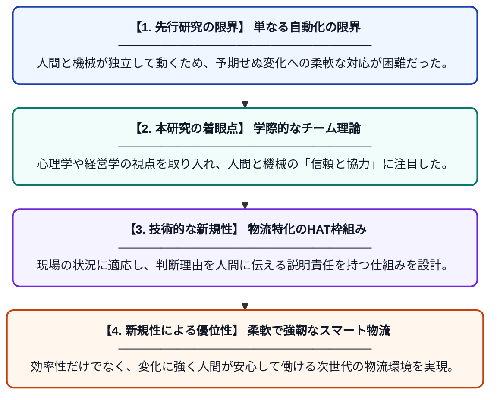

# スマート物流における人間と自律システムのチーム形成（HAT）

**Original Title**: *Human–autonomy teaming in smart logistics*

> **💡 一言要約**: 物流現場で人間とAIが「最強の相棒」になるための指針

| 項目 | 内容 |
|---|---|
| **著者** | X QIU, CH CHEN, KF YUEN, G XU |
| **掲載誌** | ENGINEERING Management 2026 |
| **アラートキーワード** | logistics |
| **原文リンク** | [https://journal.hep.com.cn/fem/EN/10.1007/s42524-026-6184-1](https://journal.hep.com.cn/fem/EN/10.1007/s42524-026-6184-1) |
| **PDF版要約** | [README.pdf](./README.pdf) |

---

## 📊 新規性の図解（先行研究との違いと本研究のブレークスルー）

## 📝 要約

AIやロボットが普及する現代の物流において、人間と自律システムが効果的に協力するための「ヒューマン・オートノミー・チーミング（HAT）」を体系化した研究です。多分野にわたるレビューに基づき、物流現場に特化した適応的かつ説明責任のある協力体制のフレームワークを提案しています。

## ❓ どんな問題に取り組んだか

物流現場へのAI導入が進む一方で、人間と機械がバラバラに動くことによる非効率性や、トラブル時の責任の所在が不明確であるという課題がありました。動的な環境変化が激しい物流分野において、人間と自律システムがどう連携すべきかという具体的な指針が不足していました。

## ✨ 何が新しい？何がすごい？（新規性）

経営学、心理学、ロボット工学といった複数の学問領域を統合し、物流に特化した人間と自律システムの協調モデルを構築した点が画期的です。単なる作業の自動化ではなく、システムが状況に応じて人間を補佐し、かつ判断の根拠を示す「説明責任」を持たせる設計指針を提示しました。これにより、現場の安全性と運用の柔軟性を同時に向上させる理論的基盤を確立しました。

## 🎓 大学1年生向けの解説

これまでの物流ロボットは、決められた作業を繰り返すだけか、人間の代わりをするだけのものでした。この研究は、人間とAIロボットがスポーツのチームメイトのように、お互いの得意なことを活かして協力する新しい働き方を提案しています。もしトラブルが起きても、ロボットが状況を判断して人間と助け合えるような、未来の倉庫や配送センターのルールを作ったような研究です。
