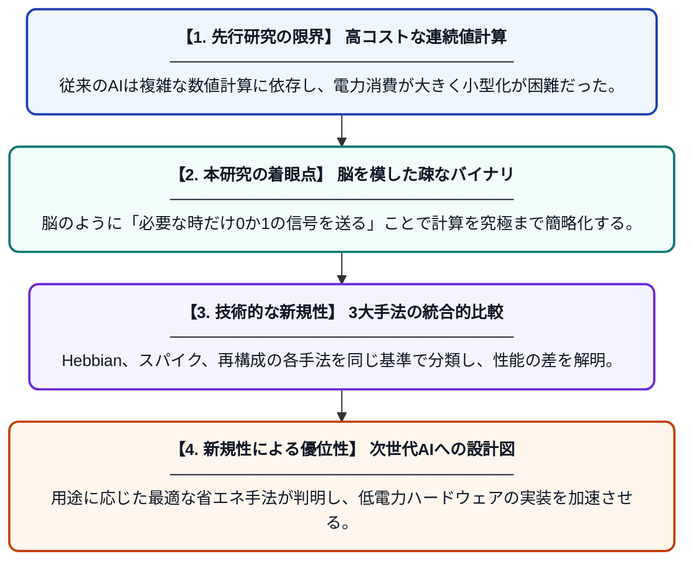

# 二値スパース符号：エネルギー効率の高い表現の現状と展望

**Original Title**: *Binary Sparse Codes: Where are we on Energy Efficient Representations?*

> **💡 一言要約**: AIを省電力にする「二値スパース符号」の最新地図

| 項目 | 内容 |
|---|---|
| **著者** | JM Ramos, L SaCouto, A Wichert |
| **掲載誌** | arXiv preprint arXiv:2610.41933 2026 |
| **アラートキーワード** | sparse coding |
| **PDF** | [https://arxiv.org/pdf/2610.41933](https://arxiv.org/pdf/2610.41933) |
| **原文リンク** | [https://arxiv.org/pdf/2610.41933](https://arxiv.org/pdf/2610.41933) |
| **PDF版要約** | [README.pdf](./README.pdf) |

---

## 📊 新規性の図解（先行研究との違いと本研究のブレークスルー）

## 📝 要約

本論文は、人工知能システムにおけるエネルギー効率の高い計算戦略として注目される「二値スパース符号（BSC）」の現状を概括しています。Hebbian型、スパイク型、再構成ベースの3つの主要なパラダイムを比較し、表現能力と省電力性のトレードオフを明らかにしています。

## ❓ どんな問題に取り組んだか

現代のディープラーニングは膨大な計算資源と電力を消費するため、環境負荷やモバイル機器への実装が大きな課題となっています。脳の仕組みを模したスパース（疎な）表現は有望ですが、それをバイナリ形式で効率的に実現する手法の体系的な整理と評価が不足していました。

## ✨ 何が新しい？何がすごい？（新規性）

本研究は、二値スパース符号を生成する手法を「Hebbian学習」「スパイクベース」「再構成ベース」の3つの枠組みで初めて包括的に分類しました。単なる手法の紹介に留まらず、エネルギー効率と表現精度の観点から各パラダイムの限界と可能性を定量的に議論しています。これにより、将来の省電力ハードウェア設計における最適なアルゴリズム選択の指針を明確に示した点が大きな貢献です。

## 🎓 大学1年生向けの解説

私たちの脳は、常にすべての神経細胞を使っているわけではなく、必要なときに一部だけを働かせる「省エネ」な仕組みを持っています。この論文は、AIにもその「省エネな情報の伝え方」を、0と1だけのシンプルな信号（バイナリ）で再現する方法を研究したものです。難しい計算を減らして、スマホや小さなロボットでも賢いAIが動くようにするための、最新の技術ロードマップと言えます。
