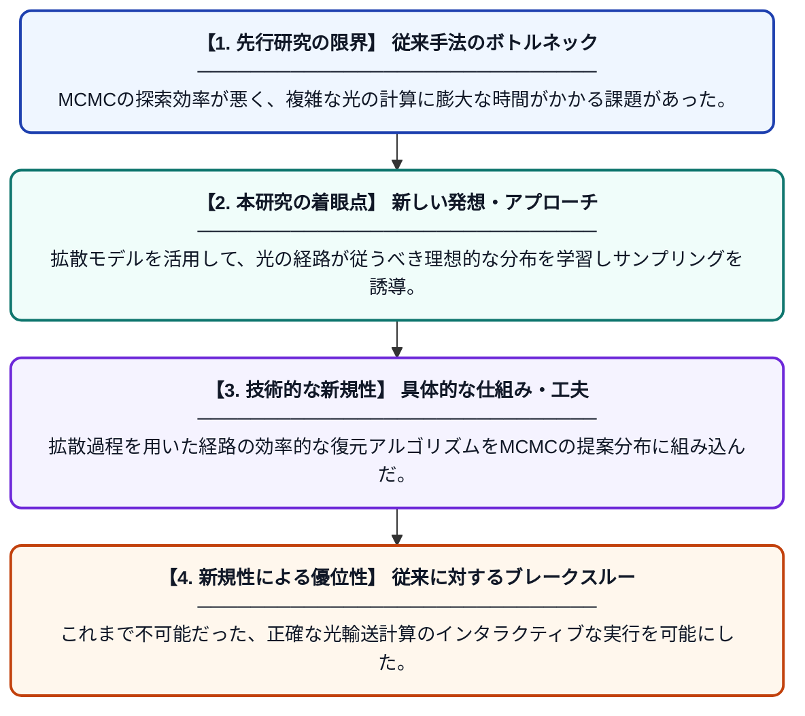

# Diffusion Restore：拡散モデルを用いたインタラクティブなMCMC光輸送シミュレーション

**Original Title**: *Diffusion Restore: Interactive Markov Chain Monte Carlo Light Transport*

> **💡 一言要約**: 拡散モデルでMCMCを革新し、爆速レンダリングを実現

| 項目 | 内容 |
|---|---|
| **著者** | S Holl, G Singh, HP Seidel |
| **掲載誌** | Proceedings of the SIGGRAPH Asia Conference … 2026 |
| **アラートキーワード** | MCMC |
| **原文リンク** | [https://dl.acm.org/doi/abs/10.1145/3829340.3842151](https://dl.acm.org/doi/abs/10.1145/3829340.3842151) |
| **PDF版要約** | [README.pdf](./README.pdf) |

---

## 📊 新規性の図解（先行研究との違いと本研究のブレークスルー）

## 📝 要約

本研究は、拡散モデルをマルコフ連鎖モンテカルロ法（MCMC）に統合し、インタラクティブな速度での高品質なレンダリングを可能にするフレームワーク「Diffusion Restore」を提案しています。複雑な光の経路を効率的に探索・復元することで、従来のMCMC手法では困難だった高速な画像生成とサンプリングの制御を実現しました。

## ❓ どんな問題に取り組んだか

従来のMCMCベースの光輸送手法は、複雑な光路の探索においてサンプリング効率が悪く、ノイズの低減に多大な時間がかかっていました。特に、ターゲットとなる分布の探索を適切に制御することが難しく、リアルタイムやインタラクティブな用途への適用は困難とされてきました。

## ✨ 何が新しい？何がすごい？（新規性）

拡散モデルをサンプリングプロセスに直接組み込み、光の経路分布を学習させることで、効率的な状態遷移を実現した点が画期的です。先行研究が静的な画像生成に拡散モデルを用いるのに対し、本研究はMCMCの探索プロセスそのものをガイドするために利用しています。これにより、極めて少ないサンプル数でも正確な光輸送をシミュレーションでき、レンダリングの大幅な高速化を達成しました。

## 🎓 大学1年生向けの解説

映画やゲームのきれいな映像を作るには、「光がどう跳ね返るか」を計算する必要があります。これまでは、その計算が非常に複雑で、1枚の画像を作るのに長い時間がかかっていました。この研究では、最近流行している「画像生成AI（拡散モデル）」の仕組みを応用することで、光の動きを賢く予測して計算をサボる方法を見つけました。その結果、複雑な光の計算を瞬時に行い、動かしながらリアルタイムで映像を表示できるようになりました。
