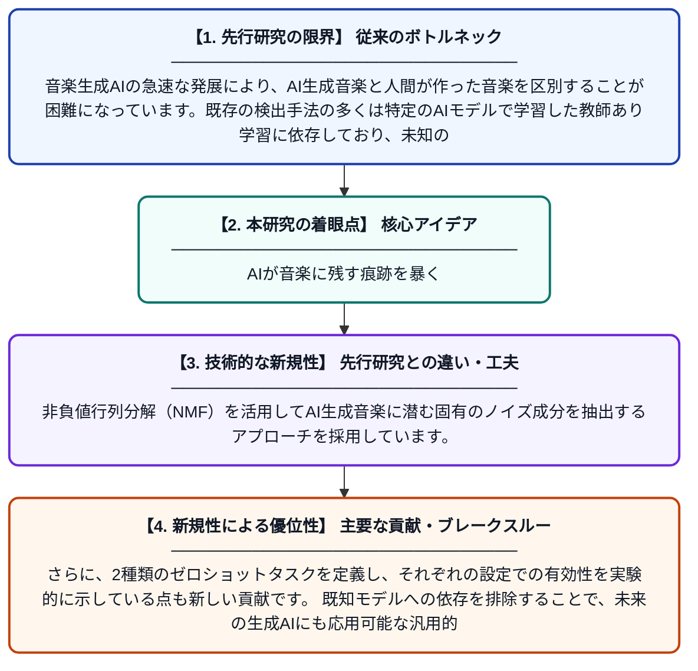

# ノイズを探し出す：ゼロショットAI音楽検出

**Original Title**: *Finding the noise: Zero-shot AI Music Detection*

> **💡 一言要約**: AIが音楽に残す痕跡を暴く

| 項目 | 内容 |
|---|---|
| **著者** | D Afchar, R Hennequin |
| **掲載誌** | arXiv preprint arXiv:2607.25530 2026 |
| **アラートキーワード** | zero shot |
| **PDF** | [https://arxiv.org/pdf/2607.25530](https://arxiv.org/pdf/2607.25530) |
| **原文リンク** | [https://arxiv.org/pdf/2607.25530](https://arxiv.org/pdf/2607.25530) |
| **PDF版要約** | [README.pdf](./README.pdf) |

---

## 📊 新規性の図解（先行研究との違いと本研究のブレークスルー）

## 📝 要約

本論文は、AIが生成した音楽を教師なし・ゼロショット設定で検出する手法を提案しています。非負値行列分解（NMF）とゼロショット学習を組み合わせ、AIが音楽生成時に残す微細なノイズパターンを手がかりに識別を行います。学習済みサンプルを必要としないため、新たに登場するAI音楽生成モデルにも柔軟に対応できる点が特徴です。

## ❓ どんな問題に取り組んだか

音楽生成AIの急速な発展により、AI生成音楽と人間が作った音楽を区別することが困難になっています。既存の検出手法の多くは特定のAIモデルで学習した教師あり学習に依存しており、未知の生成モデルに対応できません。特にゼロショット（事前学習サンプルなし）での検出手法はほとんど研究されておらず、大きな空白が存在していました。

## ✨ 何が新しい？何がすごい？（新規性）

本研究は、AI音楽検出においてゼロショット・教師なし設定に特化して取り組んだ先駆的な研究です。非負値行列分解（NMF）を活用してAI生成音楽に潜む固有のノイズ成分を抽出するアプローチを採用しています。さらに、2種類のゼロショットタスクを定義し、それぞれの設定での有効性を実験的に示している点も新しい貢献です。既知モデルへの依存を排除することで、未来の生成AIにも応用可能な汎用的な枠組みを提供しています。

## 🎓 大学1年生向けの解説

最近はAIが本物そっくりの音楽を作れるようになりましたが、それが人間の作品かAIの作品かを見分けるのはとても難しくなっています。この研究では、AIが音楽を作るときに無意識に残してしまう微細な『ノイズ（雑音のパターン）』に着目しました。面白いのは、特定のAIを事前に学習させなくても検出できる『ゼロショット』という方法を使っている点です。まるで犯罪捜査で指紋を探すように、AIが残した目に見えない痕跡を数学的に分析して正体を暴きます。これにより、まだ見たことのない新しいAI音楽生成ツールにも対応できる可能性があります。
