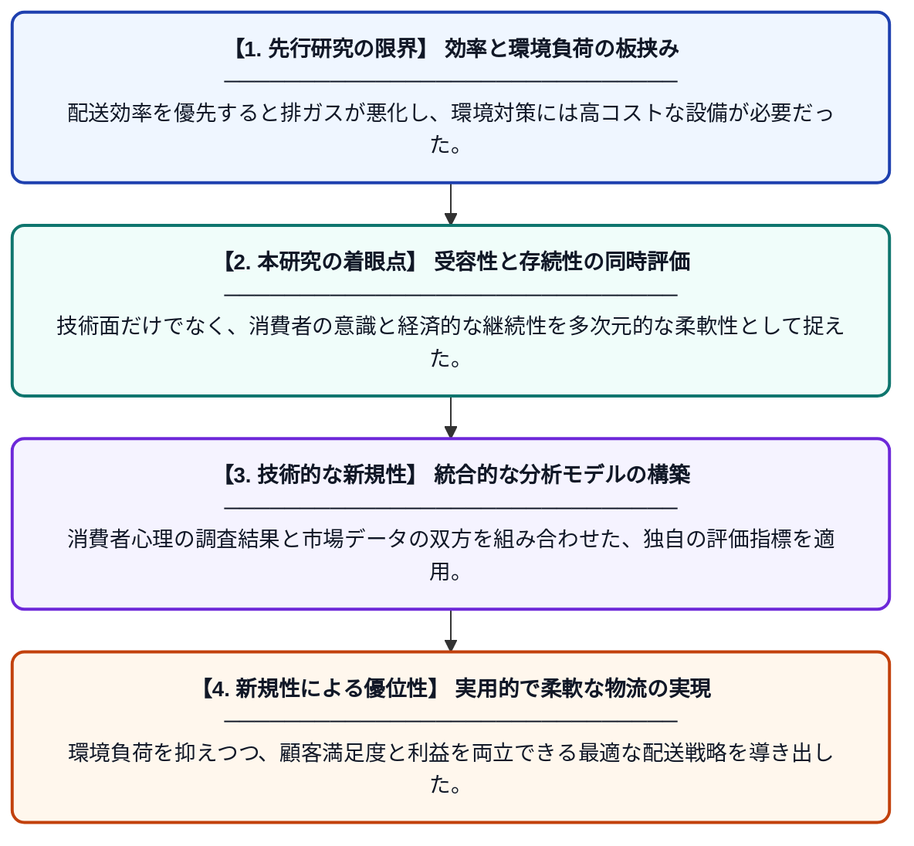

# 持続可能な都市物流における多次元的な柔軟性：e-カーゴ配送の消費者受容性と市場存続可能性

**Original Title**: *Multidimensional Flexibility in Sustainable Urban Logistics: Consumer Acceptance and Market Viability of E-Cargo Delivery*

> **💡 一言要約**: e-カーゴバイクで都市物流をクリーンに加速する

| 項目 | 内容 |
|---|---|
| **著者** | I D'Adamo, S Desideri, M Gastaldi, C Grosso… |
| **掲載誌** | Global Journal of Flexible … 2026 |
| **アラートキーワード** | logistics |
| **原文リンク** | [https://link.springer.com/article/10.1007/s40171-026-00513-y](https://link.springer.com/article/10.1007/s40171-026-00513-y) |
| **PDF版要約** | [README.pdf](./README.pdf) |

---

## 📊 新規性の図解（先行研究との違いと本研究のブレークスルー）

## 📝 要約

都市部におけるラストワンマイル配送の課題を解決するため、電動カーゴバイク（e-カーゴ）の活用に焦点を当てた研究です。多次元的な柔軟性の観点から、消費者がこの新しい配送形態をどう受け入れるか、そして市場として継続可能かを包括的に分析しています。

## ❓ どんな問題に取り組んだか

eコマースの拡大に伴い、都市部での配送による排ガス、渋滞、騒音といった環境・社会問題が深刻化しています。従来の配送車両に代わる持続可能な手段が求められていますが、その導入には配送効率と消費者の期待をどう両立させるかという課題がありました。

## ✨ 何が新しい？何がすごい？（新規性）

従来の物流研究は技術面やコストに偏りがちでしたが、本研究は「多次元的な柔軟性」という独自の枠組みを用い、消費者の心理的受容性と市場の経済的存続性を統合して評価した点が画期的です。単なる環境負荷の低減だけでなく、サービス提供側の柔軟な運用がいかに顧客満足に繋がるかを具体的に示しています。これにより、理論的な環境対策を実効性のあるビジネスモデルへと昇華させるための指針を提示しました。

## 🎓 大学1年生向けの解説

ネットショッピングで注文した荷物を、トラックではなく電動の大きな三輪自転車（e-カーゴバイク）で届ける取り組みについての研究です。トラックより空気を汚さず、狭い道もスイスイ走れるこの方法を、私たちが「使ってみたい」と思うか、そして会社が利益を出せるかを調べています。未来の街をより静かで綺麗にするための、新しい荷物の届け方のヒントが詰まっています。
