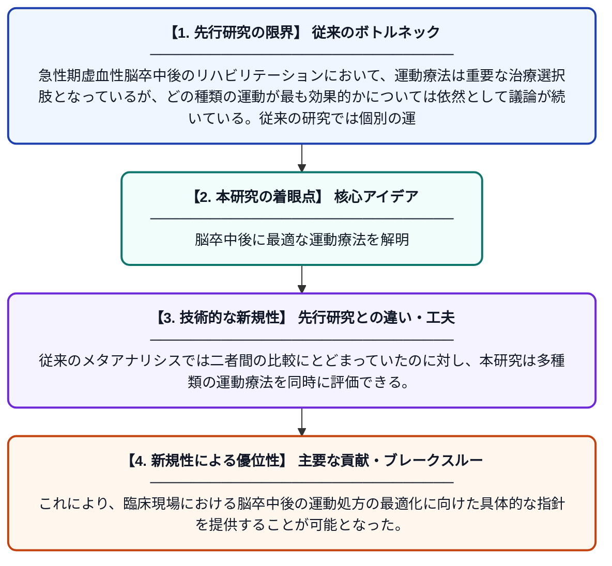

# 急性期虚血性脳卒中後の運動機能回復における運動療法の比較有効性：システマティックレビューとベイズネットワークメタアナリシス

**Original Title**: *Comparative Efficacy of Exercise Modalities for Motor Function Recovery After Acute Ischemic Stroke: A Systematic Review and Bayesian Network Meta-Analysis*

> **💡 一言要約**: 脳卒中後に最適な運動療法を解明

| 項目 | 内容 |
|---|---|
| **著者** | Z Yu, S Huang, X Peng |
| **掲載誌** | Life 2026 |
| **アラートキーワード** | bayesian network |
| **原文リンク** | [https://www.mdpi.com/2075-1729/16/8/1240](https://www.mdpi.com/2075-1729/16/8/1240) |
| **PDF版要約** | [README.pdf](./README.pdf) |

---

## 📊 新規性の図解（先行研究との違いと本研究のブレークスルー）

## 📝 要約

本研究は、急性期虚血性脳卒中後の運動機能回復に対するさまざまな運動リハビリテーション（ER）の効果を比較・検証するため、システマティックレビューとベイズネットワークメタアナリシスを実施した。PubMedなどのデータベースから関連する無作為化比較試験を収集し、複数の運動療法を同時に比較することで、最適な運動処方の特定を試みた。その結果、脳卒中後の運動機能回復において特定の運動療法が他の療法より有効である可能性が示された。

## ❓ どんな問題に取り組んだか

急性期虚血性脳卒中後のリハビリテーションにおいて、運動療法は重要な治療選択肢となっているが、どの種類の運動が最も効果的かについては依然として議論が続いている。従来の研究では個別の運動療法を単純比較するものが多く、複数の介入を同時に比較・ランク付けする包括的な検討が不足していた。

## ✨ 何が新しい？何がすごい？（新規性）

本研究は、ベイズネットワークメタアナリシスという統計手法を用いることで、直接比較データが存在しない複数の運動療法を間接的に比較し、エビデンスに基づいた有効性のランキングを初めて包括的に提示した点が新しい。従来のメタアナリシスでは二者間の比較にとどまっていたのに対し、本研究は多種類の運動療法を同時に評価できる。これにより、臨床現場における脳卒中後の運動処方の最適化に向けた具体的な指針を提供することが可能となった。

## 🎓 大学1年生向けの解説

脳卒中（脳の血管が詰まる病気）になると、手足が動かしにくくなることがあります。そのリハビリとして「運動療法」が使われますが、ウォーキング・筋トレ・水中運動など種類が多く、「どれが一番効果的か」がよくわかっていませんでした。この研究では、過去に行われた多くの実験データをまとめて、特殊な統計方法（ベイズネットワークメタアナリシス）で複数の運動法を一度に比較しました。その結果、脳卒中後の運動機能を回復させるのに特に効果的な運動の種類を明らかにすることができました。この成果は、患者さん一人ひとりに合った最適なリハビリプログラムを選ぶ手助けになります。
