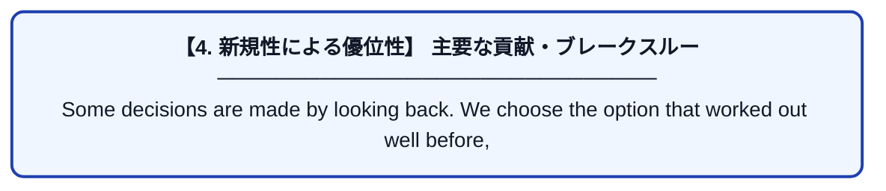

# On this page Planning and Model-based Reinforcement Learning DRAFT

| 項目 | 内容 |
|---|---|
| **著者** | CCM Course |
| **掲載誌** | Reading time 2026 |
| **アラートキーワード** | reinforcement |
| **原文リンク** | [https://teaching.gureckislab.org/ccm/readings/rl-planning.html](https://teaching.gureckislab.org/ccm/readings/rl-planning.html) |
| **PDF版要約** | [README.pdf](./README.pdf) |

---

## 📊 新規性の図解（先行研究との違いと本研究のブレークスルー）

## 📝 要約

Some decisions are made by looking back. We choose the option that worked out well before, and the more often it paid off the more likely we are to pick it again. Other decisions are made by looking ahead. Before choosing a move in chess, a …
